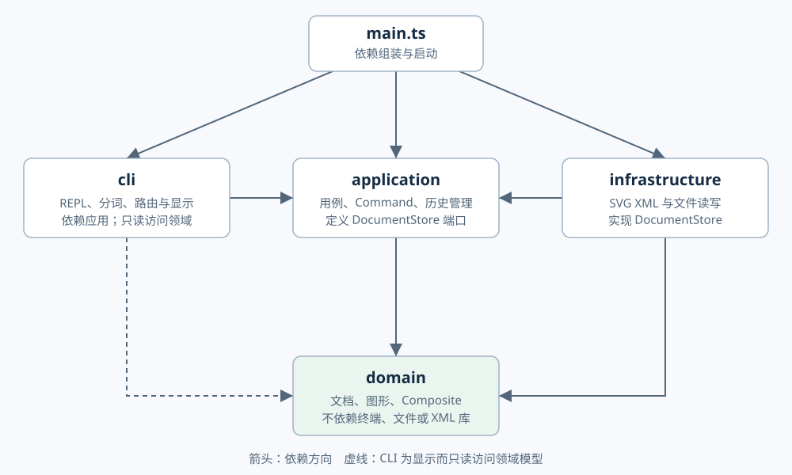
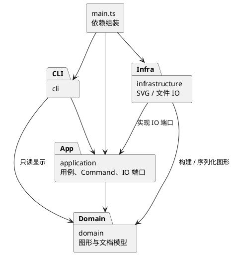
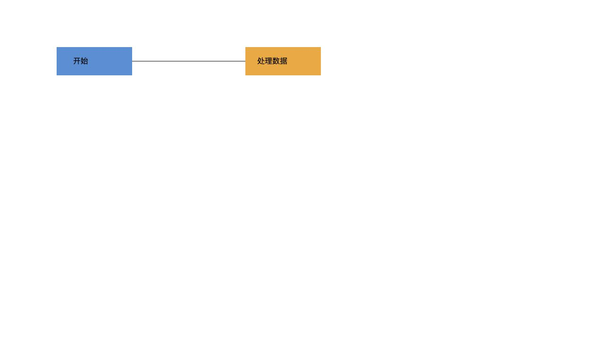
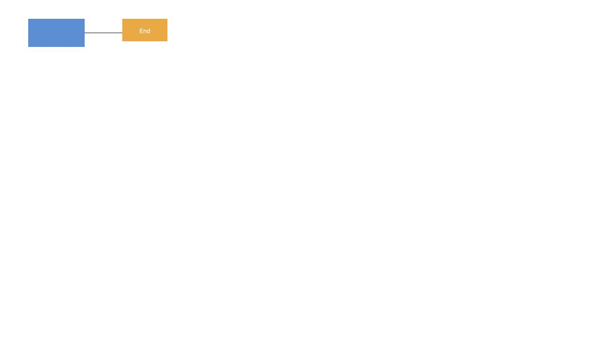

# Lab 1：架构方案与开发记录

## 1. 架构方案

本文以阶段 1 为设计基线，已更新到阶段 6：实现与要求对照、架构自查、功能验收及交付文档已整理完成；最终验收摘要见 [ACCEPTANCE.md](ACCEPTANCE.md)。

### 1.1 模块划分

| 目录 | 职责 | 主要类（DocumentStore 为接口） |
|---|---|---|
| `src/domain/` | SVG 文档、图形树、几何操作、属性校验与唯一 id 约束 | `SvgDocument`、`Shape`、`GeometricShape`、`Geometry`、`Group`、`Rect`、`Circle`、`Ellipse`、`Line`、`Text` |
| `src/application/` | 用例、编辑命令、历史管理、命令注册与图形创建；定义 IO 端口 | `EditorSession`、`Command`、`CommandHistory`、`CreateCommand`、`MoveCommand`、`ShapeFactory`、`ShapeInput`、`ReadCommand`、`SaveCommand`、`ReadResult`、`DocumentStore` |
| `src/cli/` | 终端 REPL、带引号参数解析、命令路由、文本显示及错误反馈 | `CliApplication`、`Tokenizer`、`CommandDispatcher`、`TreeFormatter` |
| `src/infrastructure/` | 文件系统适配、SVG XML 解析及序列化 | `SvgFileStore`、`SvgReader`、`SvgWriter` |
| `src/main.ts` | 创建实例、注入依赖、启动程序 | 仅组装，不承载业务逻辑 |
| `doc/` | 原始要求、架构、协作过程与验收依据 | 本文、`assignment.md` |

一类一文件，文件名与类名一致；接口亦单独命名文件。四个模块现均有实现，原占位文件已删除。`test/` 保存行为测试，`scripts/` 保存架构验收工具，均为工程辅助目录，不进入生产构建。

上图与下方 PlantUML 使用相同模块和依赖方向；可编辑源文件为 [architecture.puml](architecture.puml)。

### 1.2 设计模式的选择与落地

**Command（必选）**：命令处理器（如 `MoveCommand`）负责参数校验，每次调用生成新的编辑命令对象（如 `MoveEdit extends EditCommand`）。`EditorSession` 将其交给 `CommandHistory`，`ExecutedEdit` 持有该命令及编辑前后快照，提供执行、撤销和重做。一条成功编辑对应一个历史项；`group` 等多节点操作仍是一个单元。失败时回滚快照，历史栈保持不变；undo 后发生新的成功编辑才清空 redo。

**Memento**：`Shape.capture()` 与子类通过多态捕获私有样式、几何、文字和子节点，`SvgDocument.capture()` 再捕获文档尺寸、树与归属。历史层只持有不透明 `Memento`，不依赖图形类型名或公开数据袋。每次编辑保存完整文档的前后状态，保留图形对象身份、原父节点、顺序及属性缺省状态；redo 恢复成功后的状态而不重新计算。

这是对阶段 1“逆操作 + 必要快照”的修订：删除、跨容器分组与样式缺省值的逆操作容易漏还原，浮点缩放再取倒数还可能漂移。当前文档规模较小，选择统一完整快照，代价是每条编辑 O(N) 的时间和空间（N 为文档节点与属性总量），历史暂不设上限。若未来面对大文档，再在 CommandHistory 边界改为局部快照或增量，不提前实现持久化历史。

文档类操作不进入编辑栈。成功执行 `init/read/save` 或修改 `canvas` 后，清空历史并设置禁止撤销标记；下一次成功编辑解除标记。失败的 IO 不改状态；显示命令和只读 `canvas` 不触碰历史。

**Composite**：抽象 `Shape` 封装 id、样式与公共操作，各叶子类以多态实现几何修改；`Group` 持有私有子节点并统一操作整棵子树。`move/scale/delete/set` 通过公共抽象访问图形，不在调用方判断类型。容器 `set` 只允许公共样式属性，写在 `<g>` 上遵循 SVG 继承；叶子可覆盖样式。`scale` 缩放几何位置及尺寸，不额外缩放样式线宽。

**Factory**：`ShapeFactory` 已集中创建六种内置类型，验证几何参数、文本引号与可选样式；不预先实现插件框架。

**IO 端口与适配器**：应用层定义 `DocumentStore` 接口，`SvgFileStore` 实现文件读写，`SvgReader` / `SvgWriter` 处理 XML；`main.ts` 将适配器注入 `EditorSession`。领域对象不接触终端、文件或 XML 库。新增精确版本运行依赖 `@xmldom/xmldom@0.9.12`，API 依据[项目官方文档](https://github.com/xmldom/xmldom)。

读取复用 `ShapeFactory` 的唯一类型分派；`ShapeInput` 将 CLI 参数和 SVG 属性适配到同一创建流程。序列化根据公共属性与多态 content/children 构建 XML DOM，不新增类型名分派。XML 解析警告和错误均停止导入，不接受库自动修复后可能失真的结果。

按名字分派只安排两处：`CommandDispatcher`（命令名 → 实现）、`ShapeFactory`（图形类型 → 创建器）。两者是后续待重构点：插件阶段再改成注册机制。XML 读取复用图形工厂的类型入口，禁止另起 `switch(tag)`；几何、属性校验、显示及序列化采用类的多态方法。届时如需通用中间表示，应封装为有行为的对象，避免公开数据袋。

阶段 4 已将 create 和其余九类编辑操作全部接入历史。`Command` 接口表示可复用的请求处理器；`EditCommand` 表示一次具体编辑；`ExecutedEdit` 为其提供精确撤销与重做。

### 1.3 依赖方向规则

- `domain` 不依赖其他业务模块，也不导入 Node IO 或 XML 库，保证模型可独立验证。
- `application` 仅依赖 `domain`，以接口表达 IO 需求。
- `cli` 可以依赖 `application`，为显示只读访问 `domain`；不得直接依赖具体文件适配器。
- `infrastructure` 可以依赖 `application` 的 IO 端口及 `domain`，不得导入 CLI。
- `main.ts` 可引用以上模块完成依赖注入，不允许其他模块反向依赖入口。
- 禁止循环依赖。后续检查各文件的 import，并将违规项记录在一致性自查中。

### 1.4 变化点假设

| 可能的变化 | 当前决策 |
|---|---|
| 新增图形或复合图形 `box` | 先保证 Shape 多态和工厂集中创建；本阶段不做 ShapeProvider、box 或动态插件加载 |
| 新增命令 | Command 隔离编辑行为，命令路由集中；后续再改注册机制 |
| CLI 换成 GUI 或 agent 通道 | CLI 仅负责参数与显示，应用和领域不依赖终端 |
| 更换存储方式或 XML 库 | IO 端口隔离实现；选 XML 库前验证解析、转义、文本节点和报错行为 |
| 撤销策略变复杂 | 历史管理独立，阶段 4 改为完整前后快照；大文档场景可换为局部快照，不提前实现持久化历史 |
| 导入 SVG 的 transform 与未知元素 | 支持作业示例的 translate/正数等比 scale，导入时折算坐标、字号与线宽；六类以外图形及高级变换明确拒绝。增加新能力时须同步验证编辑与 round-trip |

### 1.5 关键不变量与实现约束

- 全文档 id 唯一且区分大小写；自动补 id 必须避开文件中已有 id（包括后续节点）。
- 图形恰有一个父容器，无循环；禁止把容器移入自身或子孙。
- `group` 拒绝同时包含祖先和子孙；保留被收编图形相对顺序，跨父容器顺序按原文档深度优先顺序确定，已测试。
- `ungroup` 拒绝 svg 直接子容器；解散合法容器时子节点占据原容器的位置。
- 参数、目标、白名单及数值须先验证，再原子提交；失败时模型、文件路径及历史均不变。
- 外部 SVG 先解析到临时文档并验证成功后再替换当前文档。
- z-order 仅在同级调整；`front` 对应后绘制（末尾），`back` 对应先绘制（开头）。

### 1.6 SVG IO 范围与事务规则

- 支持六种内置图形及几何属性、fill/stroke/stroke-width、文字子内容、嵌套与绘制顺序，以及导入展示属性（font-size、text-anchor 等）、行内 style 和根级样式。导入不再复用 set 白名单作为展示属性白名单；CLI set 白名单仍严格按原文。空或缺失 id 自动补齐，先扫描全部显式 id，避免与文件后部元素撞名；重复显式 id 拒绝读入。
- 采用 UTF-8，支持 XML 实体、CDATA、注释与 SVG 命名空间；注释不作为编辑模型的一部分保存。保存的是语义等价 SVG，不保证原文件排版、属性次序或注释不变。
- 长度支持无单位数字与 px，保留合法 viewBox（含非零原点和与画布不同的映射）。缺少根尺寸时优先使用 viewBox 宽高，否则采用 800×600；缺少图形几何参数按 0 导入。canvas 修改尺寸后重设其坐标盒，保留根级样式。
- SvgTransform 处理 translate/正数等比 scale 的列表顺序和嵌套。导入时对叶子多态调用 scale/move，折算至统一画布坐标；变换影响到的继承字号和线宽同步物化，保留 text-anchor，避免只改坐标导致文字外观改变。保存不必保留原 transform 字符串，但保证当前支持范围内的图形语义等价。
- SvgStyle 解析行内展示声明，处理引号、括号、注释、重复声明与 !important 优先级，行内样式覆盖展示属性；支持 inherit 的有效值解析。所依据的标准见 [SVG 样式](https://www.w3.org/TR/SVG/styling.html) 和 [坐标与变换](https://dev.w3.org/SVG/profiles/1.1F2/master/coords.html)。
- path 不属于规定的六类，box 明确属于后续阶段。高级变换（旋转/斜切/非等比）、完整 CSS 样式表/选择器、百分比长度和 tspan 仍不支持；遇到这些扩展能力明确报错。原文中的全部实际 SVG 示例现已可导入并往返保存。
- 读取先创建临时文档，全部校验成功后更新当前文档、默认路径及历史屏障；只有成功读入才输出补 id 警告。
- 默认保存路径取最近一次成功 read 的路径。对于 init 后的新文档，第一次显式 save 建立默认路径；显式另存其他路径不会改变该默认路径。init 清除路径。失败的 read/save 不改变路径。
- 保存先构造合法 XML，再写入同目录临时文件并 rename 原子替换；父目录须存在，拒绝目录、符号链接与只读文件。清理临时目录失败不将已经成功替换的文件报告为失败。
- 成功 read/save 清空并关闭 undo/redo，直到下一条成功编辑；失败 IO 不消耗历史项，也不清空 redo。

## 2. 过程记录

### 2026-10-28：阶段 1

- 用户要求按阶段开发，先完成环境、项目初始化和架构方案，完成后经用户 review，再提交并 push。
- 仓库初始仅含 `.gitignore`，无既有代码；终端找不到 Node.js，发现已有 Homebrew，选择安装 Node.js 24 并锁定项目主版本。
- 复核原始要求后，将 `box` 与插件系统明确排除在本阶段之外；将 Command、Composite 语义和允许分派的位置写入方案。
- 对撤销的边界作出明确决策：只在操作成功后更新历史；成功 IO 后关闭撤销，直到下一次成功编辑。
- 仅创建能运行的 CLI 骨架，不提前实现后续阶段命令；待实现目录用占位文件保留结构。
- 本记录仅记实际发生的工作，不编造用户审查意见；后续 review 与修订继续追加。

### 2026-10-28：阶段 2

- 用户 review 第一阶段后要求继续实现图形类与容器树，完成后经用户 review，再提交并 push。
- 实现六类图形、多态几何操作和 `SvgDocument` 聚合根；结构编辑集中到文档，避免调用方随意拼接图形树。
- 在实现共享几何逻辑时，采用封装的 `Geometry` 与抽象 `GeometricShape`，减少五种叶子类重复校验。各具体类声明自己的几何字段与坐标轴，不引入 `switch(tag)`。
- 检查失败原子性时发现：如果容器逐个修改子节点，后面的节点数值溢出可能留下前面节点已移动的状态。加入多态预检查，先验证整棵子树的变换结果，再修改；用“后一个节点溢出、前一个节点保持原值”的测试确认。
- 检查对象归属时发现：仅查 id 不能阻止同一对象被两个文档共享，修改一处将影响另一处。补充文档归属检查；删除子树时释放归属，测试确认共享被拒绝、删除后可转入另一文档。
- 对暴露的子节点列表和属性返回冻结副本；结构修改使用领域内部 capability。`Group.replaceChildren` 与 `treeAuthority` 是 `SvgDocument` 的内部协作 API，其他模块不得调用或导入；它不是安全隔离边界。
- 补充跨父容器分组的确定性：按原文档深度优先顺序收编，新组位于第一个被选图形的父容器中，并占据该图形原位置。这是对题目未详细规定之处的当前决策。
- 以上是本次实现与自查中实际发生的迭代，不作为用户提出过这些问题的记录。

### 2026-10-28：阶段 3

- 用户要求继续第三阶段，范围为命令解析、图形创建和信息显示；编辑命令及撤销重做留到阶段 4，文件读写留到阶段 5。
- 添加 `EditorSession`、`Command` 与基础命令类，以 `ShapeFactory` 创建六种图形；REPL 只读行、调用分发器并输出结果。
- 解析时发现直接丢掉引号信息会使文本中的 `in` 与容器尾缀难以区分。以 `Token` 保留值和是否带引号，尾缀只认未加引号的 `in`；测试覆盖 `"in" in in`、带空格文本、空文本和转义引号。
- 自查初版草稿时发现把 `text` 的特殊校验放进 CLI 会新增图形类型名分派。已将文本引号校验移入唯一的 `ShapeFactory` 分派处，CLI 仅传递引用元信息并识别通用 `in` 子句。
- `ShapeFormatter` 根据属性统一格式化，不按图形类型分支；`TreeFormatter` 递归生成树形连接符。树中矩形宽高显示为 w/h；文字采用 `x=… y=… "内容"`，show 使用逐行属性。这保留了题目要求的全部信息，不逐字符复刻示例空格与坐标排版。
- 新增 `examples/flowchart.txt`，用于回放原始作业的两节点流程图创建与显示部分；help 中明确标注尚待后续阶段实现的命令。
- 本阶段改动经用户 review 后提交并 push。

### 2026-10-28：阶段 4

- 用户要求完成第四阶段，接入 delete/move/scale/set/group/ungroup/addto/front/back 以及 undo/redo，继续保留本地改动供 review。
- 将第三阶段复用的请求处理器与单次编辑对象分离：每次请求创建新的 `*Edit` 对象，由 `CommandHistory` 在成功后加入历史。
- 复核逆操作策略时确认：几何逆变换可能产生浮点漂移；属性从“未设置”变为某值后仅用 set 不能恢复缺省；跨容器分组、解组与删除需要还原完整结构。改为 Command + Memento，并在架构方案中记录完整快照的性能代价。
- 自查快照实现时，确认不能保存可变 Geometry 对象引用后直接复用：后续 set 会污染历史。快照捕获几何副本，恢复时再次复制；测试覆盖恢复后继续 set、再连续 undo/redo，确保历史状态不被改写。
- 历史仅在操作成功后更新栈；新增故意“先修改和删除，再抛错”的测试命令，验证事务边界能还原整个文档，并保留已有 redo。
- 将 init、canvas 写操作接入历史屏障；只读 canvas 和其他显示命令不触碰历史。失败的尺寸修改不能清空历史。read/save 尚待阶段 5 接入同样规则。
- 新增 `examples/edit-history.txt` 用于演示编辑、撤销重做与修改画布后的历史重置。
- 本阶段改动经用户 review 后提交并 push。

### 2026-10-28：阶段 5

- 用户要求实现 SVG IO，随后两次中断，恢复后继续完成文档与核验；本阶段改动经用户 review 后提交并 push。
- 引入 XML DOM 库，不用正则解析 XML 树。阅读官方 API 和本地类型定义，采用严格错误回调与 requireWellFormed 序列化选项。
- 复核类型分派约束后，将导入属性和 CLI 参数通过 ShapeInput 交给同一 ShapeFactory；SvgReader 不新增 switch(tag)，SvgWriter 通过公共属性、文字与子节点序列化。
- 自查自动补 id 策略时确认：单遍见到缺 id 就分配 rect1，可能与后文显式 rect1 冲突。改为先预留全文档显式 id，再按标签计数补齐；测试覆盖后文冲突、跨层级及大小写区别。
- 读取先构建临时文档，只有成功后才替换会话；补 id 警告也先暂存。测试确认在补 id 后遇到未知元素时仅输出错误，不留下半个文档或误导性警告。
- 复核默认 save 路径时发现“另存后切换默认路径”不符合题目“无参数保存到读入时路径”的描述，调整为保留 read 路径；新文档首次显式 save 建立默认路径，并补充测试。
- 自查写入事务时，避免直接覆盖目标文件：先完成 XML 序列化，再在同目录写临时文件并原子替换。测试覆盖无父目录、只读文件、符号链接和非法 XML 字符，确认原文件内容与历史不受影响。
- 初版曾将 transform 与导入展示样式全部拒绝；后续用户指出原作业包含相关示例，确认该白名单限制过窄，已经在下述完整性修订中补齐。
- 新增 examples/other.svg、save-read.txt 及生成的 flowchart.svg。编译产物已回放保存、读回、缺 id 导入及编辑历史。
- 尝试浏览器目视检查时，本地 HTTP 预览超时，file URL 又被浏览器工具的 URL 策略拒绝；未绕过限制。临时 HTTP 服务已停止，浏览器目视结果不计为通过。

### 2026-10-28：阶段 6

- 用户要求完成下一阶段，按既定计划进行最终综合验收和文档收尾；继续遵循经用户 review 后提交并 push 的流程。
- 将此前临时执行的依赖检查固化为 scripts/ArchitectureCheck.ts，并纳入 npm run check，检查静态 import 方向、循环依赖、类名与文件名、顶层过程函数和 switch 的位置。
- 增加独立的工具类型检查配置，源码、测试及验收工具均严格检查，生产构建仍只包含 src/。
- 补充可直接查看的模块依赖 SVG 与 PlantUML 源文件，避免在普通 Markdown 阅读器中只有未渲染的代码块。
- 新增 doc/ACCEPTANCE.md，整理原文要求、测试与截图证据、支持范围、性能取舍和提交要求；保留各阶段真实记录，阶段 5 初版遗漏及用户纠正没有删除。
- 在不含原 node_modules/dist/.git 的临时目录复制当前待交付文件，按 README 运行 npm ci 和 npm run check，检验锁文件和构建的可复现性；实际结果见质量保证记录。
- 核对已有 Git 历史能看到阶段 1 至 4 的分步提交；本地没有 final 标签。远程提交和 final 标签不属于本次自动执行动作，待用户 review 后完成。

## 3. 一致性自查

| 项目 | 阶段 6 状态 |
|---|---|
| 目录与方案 | 四个模块均已落地，基础设施包括 SvgFileStore/SvgReader/SvgWriter，无目录划分偏离 |
| 一类一文件 | 新增类与接口均各自独立文件，与文件同名 |
| 依赖方向 | domain 仅依赖内部模块；application 仅依赖 domain 和自身；CLI 依赖应用与领域；入口完成启动组装 |
| Command / Composite | Composite、单次编辑命令、undo/redo 和全部文档命令的成功历史屏障均已实现并测试 |
| 类型分派 | 命令名分派仅在 `CommandDispatcher`，图形类型名分派仅在 `ShapeFactory`，按方案保留为后续重构点 |
| 修订记录 | 在原运行模块外增加 scripts/ 验收工具和工具类型配置；模块依赖规则没有变化。补充 SVG 架构图、PlantUML 源与验收摘要；导入能力与 CLI set 权限仍分开 |

## 4. 质量保证手段

### 当前阶段

`npm run check` 执行源码、测试及验收工具的严格类型检查、62 个源码文件的架构规则检查、生产代码编译及领域、命令、历史和文件 IO 行为测试。测试使用 Node 内建 test runner，通过 tsx 运行；XML 库是运行依赖。源码和测试分开配置，生产构建不包含测试文件。启动骨架的检查结果保留在阶段 1 记录中。

### 完整作业验收清单（已按原文功能核对，扩展能力范围见 1.6）

- 领域测试：六类图形、浮点坐标、容器递归移动缩放、属性白名单、唯一 id、树结构及 z-order。
- 历史测试：编辑执行→撤销→重做，分组与删除的完整还原，新编辑清空 redo，IO 屏障以及失败原子性。
- CLI 测试：双引号文本、颜色中的 `#` 不视为整行注释、无文档错误、帮助与树形显示。
- SVG round-trip：保存→读取后语义一致；验证 XML 特殊字符、文字内容、缺 id 冲突及文件失败。
- 回放原始作业典型会话和两节点流程图，在浏览器打开输出 SVG 进行目视验收。
- 最后核对每条命令、错误约定、目录与依赖规则；如实记录仍未支持的行为。

具体执行结果与限制按下方历史记录和 [最终验收摘要](ACCEPTANCE.md) 复核，不以计划替代测试结果。

### 阶段 1 实际验证结果（2026-10-28）

- 环境：Homebrew 安装 Node.js `v24.22.1`，npm `11.19.1`；未修改用户 shell 配置，运行前按根 README 将 Node 路径加入当前终端。
- `npm install` 成功，生成并保留 `package-lock.json`，开发依赖按精确版本保存；npm 审计报告 0 个漏洞。
- 安装时可选的 `fsevents` 原生组件耗时较长，最终安装流程自行完成；未额外改变安装策略。
- `npm run check` 通过：严格类型检查与编译均成功。
- 管道输入空行、注释及 `init 800 600`，`npm run cli` 正常显示提示符，忽略前两者，对命令报告阶段 1 尚未实现，EOF 正常退出。
- `npm start` 成功运行编译后的 JavaScript，并正常处理注释与 EOF。
- `git diff --check` 无报错；构建产物和依赖目录均被已有 `.gitignore` 忽略。
- 尚未做真实图形操作测试，因为这些功能属于后续阶段；本阶段经用户 review 后提交并 push，全部作业验收后再创建 `final` 标签。

### 阶段 2 实际验证结果（2026-10-28）

- `npm run check` 通过：源码与测试均通过严格类型检查，构建成功，10 个领域行为测试全部通过。
- 已验证六类图形、浮点与负坐标、几何字段白名单、非负尺寸、容器样式继承存储、文本内容修改。
- 已验证容器递归移动和缩放、数值溢出的失败原子性、全局 id 唯一及大小写敏感、目标容器校验、循环层级拒绝、分组/解组顺序、同级前后排序、删除子树、跨文档归属和只读快照。
- `git diff --check` 通过；核对领域模块 import，没有向外层模块或 IO 库的依赖。
- CLI 未接入领域操作，尚无命令解析、文件 IO 或撤销重做，不以领域测试代替这些功能的最终验收。
- 阶段 2 的改动经用户 review 后提交并 push。

### 阶段 3 实际验证结果（2026-10-28）

- `npm run check` 通过：源码和测试严格类型检查、构建，以及 18 个测试（10 个领域测试、8 个 CLI/集成测试）。
- 验证无文档错误、帮助语法、待实现命令提示、六种图形与可选样式、父容器指定、带引号文本、颜色中的 #、不闭合引号、未知类型、非法参数和失败后文档不变。
- 验证 tree 的递归连接符、几何属性与局部子树，show 的父容器和属性明细，以及 canvas 查看和修改。
- 实际启动源码 REPL 输入命令脚本，确认错误后继续运行并在 EOF 正常退出。
- 使用 `npm start < examples/flowchart.txt` 验证编译产物，完整创建并显示两节点流程图。
- `git diff --check` 通过；检查各模块导入及类型名分派位置，未发现依赖方向违规或额外的图形类型名分派。
- 本阶段改动经用户 review 后提交并 push。SVG 保存、其他编辑命令及撤销历史尚未实现，不包含在本阶段通过的验收范围。

### 阶段 4 实际验证结果（2026-10-28）

- `npm run check` 通过：源码和测试严格类型检查、构建，以及 27 个测试（原有 18 个和新增 9 个历史场景）。
- 所有十类编辑操作（含 create）的前后状态均验证 undo/redo；验证连续撤销到空画布，再按原序重做。
- 验证跨父容器 group、ungroup、addto、front/back、删除子树，原父节点、顺序、对象身份和 id 归属可恢复。
- 验证新编辑清空 redo，显示命令与失败命令保留 redo；非法结构、数值溢出与部分执行后失败均不改变有效历史。
- 验证 init/canvas 写操作的屏障、失败尺寸修改保留历史、下一次成功编辑解除屏障，以及属性缺省与浮点值精确恢复。
- 实际使用编译产物回放 `examples/edit-history.txt`，无 error 输出；原两节点流程图脚本仍可运行。
- `git diff --check` 通过；检查导入和类型分派，没有引入领域层向外依赖或额外的图形类型名分派。
- 本阶段改动经用户 review 后提交并 push；SVG read/save 尚未实现，其 IO 失败与历史屏障的集成验收留到阶段 5。

### 阶段 5 实际验证结果（2026-10-28）

- `npm run check` 通过：源码与测试严格类型检查、构建，以及 40 个测试（原有 27 个和新增 13 个 IO 场景）。
- 验证作业的 other.svg、缺 id 自动补全与冲突避让、重复 id 拒绝、完整层级、绘制顺序、元素计数和六类图形 round-trip。
- 验证实体、CDATA、空文字、注释、命名空间前缀、浮点与 px 长度、样式缺省值，以及非法 XML 与不支持语义的明确拒绝。
- 验证带空格路径、默认保存路径、成功 IO 历史屏障、失败 IO 保留文档/路径/redo、读取替换旧文档，以及新编辑解除历史屏障。
- 验证临时文件原子保存、缺失父目录、只读文件、目录、符号链接、非法 XML 字符和临时目录清理；失败时原文件内容保持不变。
- 编译产物成功回放 examples/save-read.txt，保存 8 个元素的流程图并读回，随后导入 7 个元素的 other.svg，正确警告 rect1 补全并执行移动与撤销重做。
- 首次自动预览未成功；后续按用户要求重试，本地 HTTP 预览成功。已目视确认蓝色“开始”节点、橙色“处理数据”节点、中文及连接线正常显示，截图见下方。
- 依赖安装时 npm audit 报告 0 个漏洞；本阶段经用户 review 后提交并 push，final 标签留待全部作业验收后创建。

- 恢复工作后已补齐两份 README，并检查全部源码 import：没有依赖方向违规、未解析内部模块或循环依赖；`git diff --check` 通过。

### 阶段 5 浏览器目视复核

按用户要求再次启动本地 HTTP 服务，先确认返回 HTTP 200 与 image/svg+xml，再通过浏览器打开同一 SVG 并截图。
已确认两个矩形颜色、中文文字与连接线显示正常，未见缺失、裁切或位置异常。首次超时的具体原因未确认，不归因于 SVG 文件。
本次结果替代此前“目视尚未完成”的状态；截图后已关闭临时预览标签并停止 HTTP 服务。

### 阶段 5 完整性修订：根据用户 review 纠正遗漏

用户指出“不支持 transform、CSS、path”不能混为一个未完成项，并要求按照原始作业保证功能完整性。对照 0.1 与 3/4 节后确认：path 不在规定六类中，但原文明确展示了嵌套 translate/scale、font-size/text-anchor；此前只回放简单文件、不验收这些示例的策略不充分。

已完成修订：

- 把作业原始 transform 示例保存为 examples/assignment-transform.svg；自动抽取原文所有完整 SVG（包括带根级 style 的预览）作为读取和 round-trip 回归用例，避免只验证本程序自己的输出。
- 将变换按 SVG 顺序归一到叶子几何坐标，处理嵌套继承字号和线宽；新增导入展示属性与行内样式处理，保留 root viewBox、style 等信息。
- 保持 CLI set 的原白名单；font-size/text-anchor 可导入、显示、保存，不额外成为可 set 属性。
- 校验 group 至少包含 id1/id2 两个图形；验证不合法操作不会改变树或 redo。
- 回放原文第 6 节全部命令，只有原文给出的非法祖孙分组和 save 后 undo 两条预期错误；保存的 5 个元素、移动后的 cx=130、撤销后的标题和恢复的父容器均正确。
- `npm run check` 通过：严格类型检查、构建、51 个测试。原有 40 个测试保留并按新增支持范围更新，新增 11 个原文验收与边界场景。
- 编译产物回放 examples/transform-roundtrip.txt 成功，导入补齐 rect1/text1 后保存读回，再执行移动及 undo/redo，未出现非预期错误。
- 浏览器分别打开原始 transform 示例和保存结果，目视确认矩形、连线、白色居中文字及缩放效果一致；两张截图 SHA-256 相同：db6935498d62f86f80629a9609405c4a987c10b91e2bbf4393a279bf23551e84。

原始示例：

保存读回结果：

### 原文要求与验收证据

| 原文要求 | 验收证据 |
|---|---|
| TypeScript、面向对象、一类一文件、Command | domain 类层次与 Composite、application 单次 EditCommand/ExecutedEdit/CommandHistory；文件与依赖检查 |
| init/read/save/canvas | cli.test.ts、io.test.ts：默认尺寸、默认路径、文件事务、IO 屏障 |
| 六类 create、唯一 id、in | cli.test.ts、domain.test.ts、io.test.ts：六类参数、归属、补 id、重复 id 拒绝 |
| delete/move/scale/set | domain.test.ts、history.test.ts：几何、属性白名单、子树、溢出原子性 |
| group/ungroup/addto/front/back | domain.test.ts、history.test.ts、requirements.test.ts：顺序、层级、循环拒绝、至少两成员 |
| tree/show/help | cli.test.ts：结构连接符、内联几何、子树与父节点、完整语法 |
| undo/redo | history.test.ts、io.test.ts：逐条和连续恢复、新编辑清空 redo、失败不消费历史 |
| 注释、双引号、颜色、错误前缀 | cli.test.ts、requirements.test.ts：token 与真实 REPL 脚本、错误表精确核对 |
| 原文 SVG 背景示例 | requirements.test.ts：全部完整 SVG、嵌套变换、字号、居中、行内样式与 round-trip；浏览器截图 |
| 原文完整会话与流程图 | requirements.test.ts 第 6 节命令回放；examples/flowchart.txt、save-read.txt、transform-roundtrip.txt 与浏览器验证 |
| Git 分步提交与 final tag | 仍按用户 review 后提交并 push；final tag 必须在最终确认及截止时间前由交付流程完成，不把本地功能测试当成已交作业 |

以上是对作业明确要求及其实际示例的功能核对，不表示实现了 SVG 标准的所有扩展能力。

修订后再次检查全部源码 import，未发现依赖方向违规或循环依赖；`git diff --check` 通过。验证用浏览器标签已关闭，临时 HTTP 服务已停止。本批修改经用户 review 后提交并 push。

### 阶段 6 实际验证结果（2026-10-28）

- 在独立临时目录中按 README 执行 npm ci 成功，无旧 node_modules/dist；安装后 audit 报告 0 个漏洞。
- 同目录 npm run check 成功：源码/测试/工具严格类型检查、62 个源码文件架构检查、生产构建及 51 个测试全部通过。
- 使用新构建的 dist/main.js 回放四份 examples/*.txt 示例，均退出码 0，未出现 error 输出。
- 两份 README 与最终验收文档的本地链接均存在；SVG 架构图已通过浏览器目视检查，模块说明、依赖箭头与图例无重叠或裁切。验证后已关闭浏览器标签并停止临时服务。
- 本阶段没有新增运行时依赖，也没有发现需要再改业务逻辑的必做功能缺口。新增内容集中在可重复的架构检查、架构图和交付验收记录。
- `git diff --check` 通过；阶段 1 至 4 的提交历史已核对。当前本地第 5、6 阶段改动仍经用户 review 后提交并 push；final 标签留到最终提交确认后创建。
