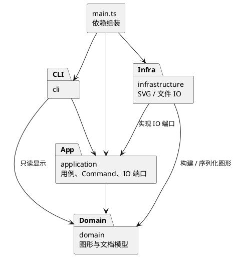

# Lab 1：架构方案与开发记录

## 1. 架构方案

本文是阶段 1 的设计基线；下述模型、命令与 IO 类为计划，尚未实现。

### 1.1 模块划分

| 目录 | 职责 | 计划中的主要类 |
|---|---|---|
| `src/domain/` | SVG 文档、图形树、几何操作、属性校验与唯一 id 约束 | `SvgDocument`、`Shape`、`Group`、`Rect`、`Circle`、`Ellipse`、`Line`、`Text` |
| `src/application/` | 用例、编辑命令、历史管理、命令注册与图形创建；定义 IO 端口 | `EditorSession`、`Command`、`CommandHistory`、`CreateCommand`、`MoveCommand`、`ShapeFactory`、`DocumentStore` |
| `src/cli/` | 终端 REPL、带引号参数解析、命令路由、文本显示及错误反馈 | `CliApplication`、`Tokenizer`、`CommandDispatcher`、`TreeFormatter` |
| `src/infrastructure/` | 文件系统适配、SVG XML 解析及序列化 | `SvgFileStore`、`SvgReader`、`SvgWriter` |
| `src/main.ts` | 创建实例、注入依赖、启动程序 | 仅组装，不承载业务逻辑 |
| `doc/` | 原始要求、架构、协作过程与验收依据 | 本文、`assignment.md` |

一类一文件，文件名与类名一致；接口亦单独命名文件。尚无实现的目录暂以 `.gitkeep` 占位，避免先造空类。

### 1.2 设计模式的选择与落地计划

**Command（必选）**：每条编辑操作对应命令对象，暴露执行与撤销能力。`CommandHistory` 管理 undo/redo 栈；一条命令成功后才入栈，失败不改变模型和历史。`group` 等多节点操作作为一个命令单元，保留原父节点、位置和顺序；`delete` 保留整棵子树供撤销。撤销后发生新的成功编辑才清空 redo。

文档类操作不进入编辑栈。成功执行 `init/read/save` 或修改 `canvas` 后，清空历史并设置禁止撤销标记；下一次成功编辑解除标记。失败的 IO 不改状态；显示命令和只读 `canvas` 不触碰历史。

**Composite**：抽象 `Shape` 封装 id、样式与公共操作，各叶子类以多态实现几何修改；`Group` 持有私有子节点并统一操作整棵子树。`move/scale/delete/set` 通过公共抽象访问图形，不在调用方判断类型。容器 `set` 只允许公共样式属性，写在 `<g>` 上遵循 SVG 继承；叶子可覆盖样式。`scale` 缩放几何位置及尺寸，不额外缩放样式线宽。

**Factory**：`ShapeFactory` 集中创建六种内置类型；不预先实现插件框架。

**IO 端口与适配器**：应用层定义 `DocumentStore` 接口，基础设施实现文件读写。领域对象不接触终端、文件或 XML 库。

按名字分派只安排两处：`CommandDispatcher`（命令名 → 实现）、`ShapeFactory`（图形类型 → 创建器）。两者是后续待重构点：插件阶段再改成注册机制。XML 读取复用图形工厂的类型入口，禁止另起 `switch(tag)`；几何、属性校验、显示及序列化采用类的多态方法。届时如需通用中间表示，应封装为有行为的对象，避免公开数据袋。

### 1.3 依赖方向规则

- `domain` 不依赖其他业务模块，也不导入 Node IO 或 XML 库，保证模型可独立验证。
- `application` 仅依赖 `domain`，以接口表达 IO 需求。
- `cli` 可以依赖 `application`，为显示只读访问 `domain`；不得直接依赖具体文件适配器。
- `infrastructure` 可以依赖 `application` 的 IO 端口及 `domain`，不得导入 CLI。
- `main.ts` 可引用以上模块完成依赖注入，不允许其他模块反向依赖入口。
- 禁止循环依赖。后续检查各文件的 import，并将违规项记录在一致性自查中。

### 1.4 变化点假设

| 可能的变化 | 当前决策 |
|---|---|
| 新增图形或复合图形 `box` | 先保证 Shape 多态和工厂集中创建；本阶段不做 ShapeProvider、box 或动态插件加载 |
| 新增命令 | Command 隔离编辑行为，命令路由集中；后续再改注册机制 |
| CLI 换成 GUI 或 agent 通道 | CLI 仅负责参数与显示，应用和领域不依赖终端 |
| 更换存储方式或 XML 库 | IO 端口隔离实现；选 XML 库前验证解析、转义、文本节点和报错行为 |
| 撤销策略变复杂 | 历史管理独立，先用命令逆操作及必要的私有快照，不提前实现持久化历史 |
| 导入 SVG 的 transform 与未知元素 | 原始要求有 transform 背景示例，但未完整规定支持范围；在 IO 阶段明确支持和拒绝策略，禁止静默丢失图形语义 |

### 1.5 关键不变量与实现约束

- 全文档 id 唯一且区分大小写；自动补 id 必须避开文件中已有 id（包括后续节点）。
- 图形恰有一个父容器，无循环；禁止把容器移入自身或子孙。
- `group` 拒绝同时包含祖先和子孙；保留被收编图形相对顺序，跨父容器顺序计划按原文档深度优先顺序确定并测试。
- `ungroup` 拒绝 svg 直接子容器；解散合法容器时子节点占据原容器的位置。
- 参数、目标、白名单及数值须先验证，再原子提交；失败时模型、文件路径及历史均不变。
- 外部 SVG 先解析到临时文档并验证成功后再替换当前文档。
- z-order 仅在同级调整；`front` 对应后绘制（末尾），`back` 对应先绘制（开头）。

## 2. 过程记录

### 2026-10-28：阶段 1

- 用户要求按阶段开发，先完成环境、项目初始化和架构方案，保留本地改动供 review，不推送。
- 仓库初始仅含 `.gitignore`，无既有代码；终端找不到 Node.js，发现已有 Homebrew，选择安装 Node.js 24 并锁定项目主版本。
- 复核原始要求后，将 `box` 与插件系统明确排除在本阶段之外；将 Command、Composite 语义和允许分派的位置写入方案。
- 对撤销的边界作出明确决策：只在操作成功后更新历史；成功 IO 后关闭撤销，直到下一次成功编辑。
- 仅创建能运行的 CLI 骨架，不提前实现后续阶段命令；待实现目录用占位文件保留结构。
- 本记录仅记实际发生的工作，不编造用户审查意见；后续 review 与修订继续追加。

## 3. 一致性自查

| 项目 | 阶段 1 状态 |
|---|---|
| 目录与方案 | 四个计划模块目录均已创建；只有 CLI 有实现，其余待后续阶段填充 |
| 一类一文件 | 当前仅 `CliApplication.ts` 声明类，`main.ts` 只启动程序 |
| 依赖方向 | 当前 CLI 仅导入 Node 终端 API；入口依赖 CLI，无反向或循环业务依赖 |
| Command / Composite | 尚未实现；不能据此宣称作业功能达标 |
| 修订记录 | 首版架构基线，后续变化在此说明原因与影响 |

## 4. 质量保证手段

### 当前阶段

使用严格 TypeScript 检查和实际编译验证项目配置，实际启动源码和编译产物检查提示符、空行、注释与 EOF 行为。不为启动骨架编写镜像实现的单元测试。

### 后续验收计划（尚未执行）

- 领域测试：六类图形、浮点坐标、容器递归移动缩放、属性白名单、唯一 id、树结构及 z-order。
- 历史测试：编辑执行→撤销→重做，分组与删除的完整还原，新编辑清空 redo，IO 屏障以及失败原子性。
- CLI 测试：双引号文本、颜色中的 `#` 不视为整行注释、无文档错误、帮助与树形显示。
- SVG round-trip：保存→读取后语义一致；验证 XML 特殊字符、文字内容、缺 id 冲突及文件失败。
- 回放原始作业典型会话和两节点流程图，在浏览器打开输出 SVG 进行目视验收。
- 最后核对每条命令、错误约定、目录与依赖规则；如实记录仍未支持的行为。

具体执行结果与限制随阶段补充，不以计划替代测试结果。

### 阶段 1 实际验证结果（2026-10-28）

- 环境：Homebrew 安装 Node.js `v24.22.1`，npm `11.19.1`；未修改用户 shell 配置，运行前按根 README 将 Node 路径加入当前终端。
- `npm install` 成功，生成并保留 `package-lock.json`，开发依赖按精确版本保存；npm 审计报告 0 个漏洞。
- 安装时可选的 `fsevents` 原生组件耗时较长，最终安装流程自行完成；未额外改变安装策略。
- `npm run check` 通过：严格类型检查与编译均成功。
- 管道输入空行、注释及 `init 800 600`，`npm run cli` 正常显示提示符，忽略前两者，对命令报告阶段 1 尚未实现，EOF 正常退出。
- `npm start` 成功运行编译后的 JavaScript，并正常处理注释与 EOF。
- `git diff --check` 无报错；构建产物和依赖目录均被已有 `.gitignore` 忽略。
- 尚未做真实图形操作测试，因为这些功能属于后续阶段；当前没有 commit、push 或 `final` 标签。
