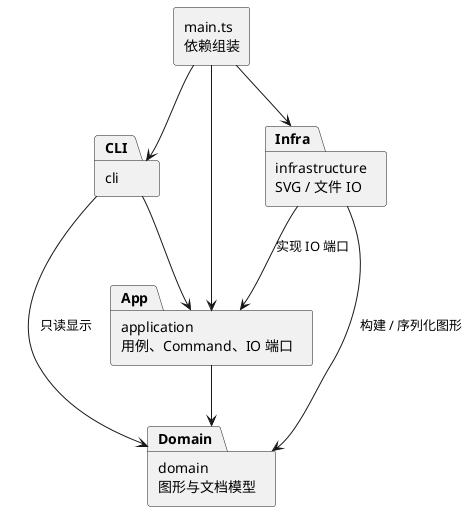
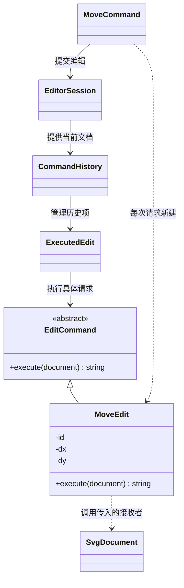
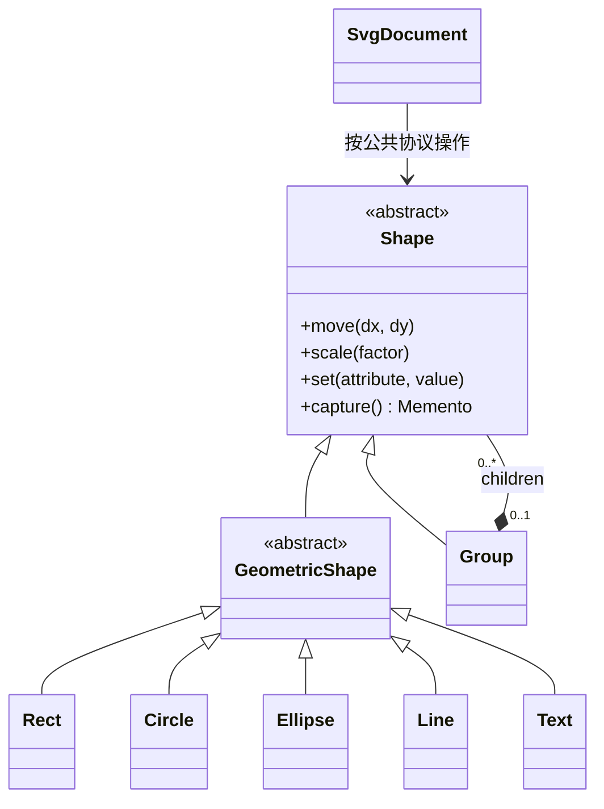
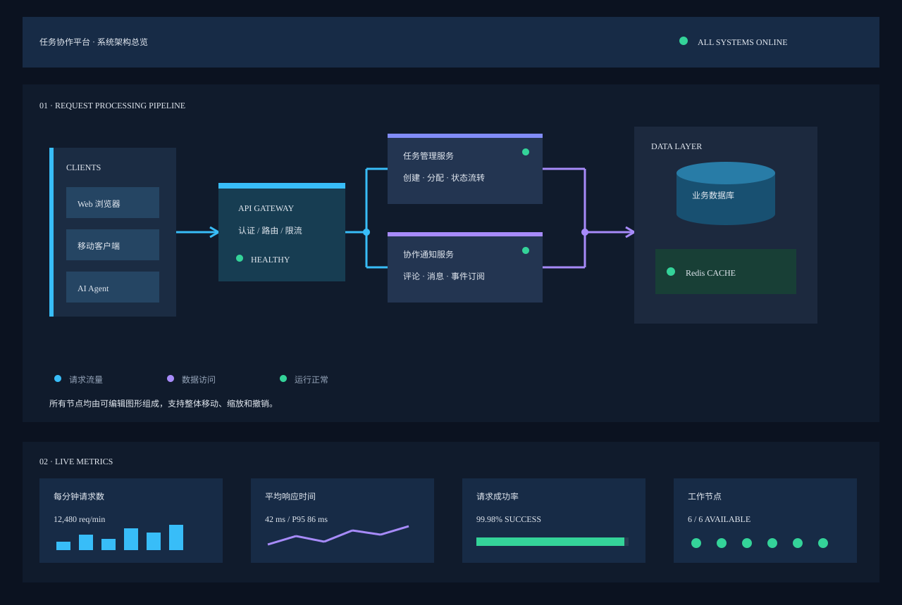

# Lab 1：架构方案与开发记录

## 1. 架构方案

本文以阶段 1 为设计基线，已更新到阶段 6：实现与要求对照、架构自查、功能验收及交付文档已整理完成；最终验收摘要见 [ACCEPTANCE.md](ACCEPTANCE.md)，主要功能手动验证见 [MANUAL_TEST.md](MANUAL_TEST.md)。

### 1.1 模块划分

| 目录 | 职责 | 主要类（DocumentStore 为接口） |
|---|---|---|
| `src/domain/` | SVG 文档、图形树、几何操作、属性校验与唯一 id 约束 | `SvgDocument`、`Shape`、`GeometricShape`、`Geometry`、`Group`、`Rect`、`Circle`、`Ellipse`、`Line`、`Text` |
| `src/application/` | 用例、编辑命令、历史管理、命令注册与图形创建；定义 IO 端口 | `EditorSession`、`Command`、`CommandHistory`、`CreateCommand`、`MoveCommand`、`ShapeFactory`、`ShapeInput`、`ReadCommand`、`SaveCommand`、`ReadResult`、`DocumentStore` |
| `src/cli/` | 终端 REPL、带引号参数解析、命令路由、文本显示及错误反馈 | `CliApplication`、`Tokenizer`、`CommandDispatcher`、`TreeFormatter` |
| `src/infrastructure/` | 文件系统适配、SVG XML 解析及序列化 | `SvgFileStore`、`SvgReader`、`SvgWriter` |
| `src/main.ts` | 创建实例、注入依赖、启动程序 | 仅组装，不承载业务逻辑 |
| `doc/` | 原始要求、架构、协作过程与验收依据 | 本文、`assignment.md` |

一类一文件，文件名与类名一致；接口亦单独命名文件。四个模块现均有实现，原占位文件已删除。`test/` 保存行为测试，`scripts/` 保存架构验收工具，均为工程辅助目录，不进入生产构建。

上图与下方 PlantUML 使用相同模块和依赖方向；可编辑源文件为 [architecture.puml](architecture.puml)。

### 1.2 设计模式的选择与落地

本项目核心采用三个 GoF 设计模式：**Command（命令）、Composite（组合）、Memento（备忘录）**。下面分别说明它们的实际角色和协作；简单工厂及 IO 架构手段另行分类。

这里按“要解决的设计问题 → 模式角色 → 实际类与协作 → 收益和代价”说明。设计模式描述一组对象在特定问题下的职责分配和协作结构，不能仅凭类名中有 Command/Factory，或使用了接口、继承，就认定采用了某个模式。

本项目的模式选择如下：

| 方案 | 分类 | 本项目要解决的问题 | 当前实现 |
|---|---|---|---|
| Command（命令，作业必选） | GoF 行为型模式 | 把一次编辑封装为对象，使触发请求、执行修改与历史管理分离 | `EditCommand`、各 `*Edit`、`CommandHistory`、`ExecutedEdit` |
| Composite（组合） | GoF 结构型模式 | 将叶子和嵌套容器组织成树，对二者使用统一图形操作 | `Shape`、`Group`、五种叶子类 |
| Memento（备忘录） | GoF 行为型模式 | 在不暴露私有状态的情况下，为撤销、重做和失败回滚保留状态 | `Memento`、领域对象的 `capture()`、`ExecutedEdit` |
| Simple Factory（简单工厂） | 集中创建对象的惯用法，不是 GoF 工厂方法或抽象工厂 | CLI 创建和 SVG 导入复用同一套类型创建规则 | `ShapeFactory`、`ShapeInput` |
| IO 端口、依赖反转和依赖注入 | 架构组织方式与设计原则，不单独计为 GoF 模式 | 应用与领域不依赖文件系统和 XML 库 | `DocumentStore`、`SvgFileStore`、`main.ts` |

#### 1.2.1 Command：把“一次编辑请求”封装成对象

**问题与选择理由。** 用户既能执行 `move`、`group`、`delete` 等不同编辑，又要求“一条编辑命令 = 一个 undo 单元”。如果 CLI 分发器直接完成所有修改，并在 undo 中再次按命令名分支恢复，新增编辑就必须同时修改分发、执行和撤销逻辑。采用 Command 后，历史管理只处理编辑命令抽象，不需要知道某次编辑是在移动矩形还是删除容器。

**角色与代码对应。** 本项目存在两个不同层次的“命令”，须区分其职责：

| 模式角色或协作职责 | 实际代码 | 具体职责 |
|---|---|---|
| Command：编辑命令抽象 | [`EditCommand`](../src/application/EditCommand.ts) | 定义 `execute(document): string`，代表一次待执行编辑 |
| ConcreteCommand：具体编辑命令 | [`MoveEdit`](../src/application/MoveEdit.ts)，以及 `CreateEdit/DeleteEdit/ScaleEdit/SetEdit/GroupEdit/UngroupEdit/AddToEdit/FrontEdit/BackEdit` | 保存该次请求的参数，并实现对文档的具体修改 |
| Receiver：接收者 | [`SvgDocument`](../src/domain/SvgDocument.ts)，再委托给 `Shape` 子类 | 真正持有文档并完成图形、几何和层级操作 |
| Invoker：调用者 | [`CommandHistory`](../src/application/CommandHistory.ts) | 接收统一的 `EditCommand`，调度执行，管理 undo/redo 栈及 IO 屏障 |
| Client：组装具体请求 | [`MoveCommand`](../src/application/MoveCommand.ts) 等 CLI 请求处理器 | 校验参数，每次创建一个新的具体编辑对象，如 `new MoveEdit(id, dx, dy)` |
| 会话协调者 | [`EditorSession`](../src/application/EditorSession.ts) | 向历史管理器提供当前文档；协调 init/read/save/canvas 与历史边界 |
| 执行记录与撤销包装 | [`ExecutedEdit`](../src/application/ExecutedEdit.ts) | 持有本次编辑对象、前后备忘录和反馈摘要，统一提供 execute/undo/redo |

[`Command`](../src/application/Command.ts) 接口定义的是可复用 CLI 请求处理器的 `execute(args)`；`MoveCommand` 这种处理器可被多次调用。历史中的具体编辑对象是每次新建的 `MoveEdit`。二者不能仅因名字相似而混为一个角色。

**以 `move r1 30 0` 为例，实际协作过程如下：**

1. `CommandDispatcher` 将请求交给 `MoveCommand.execute(args)`。
2. `MoveCommand` 解析参数，创建 `MoveEdit("r1", 30, 0)`，调用 `session.edit(edit)`。
3. `EditorSession` 把编辑对象和当前文档交给 `CommandHistory.execute(edit, document)`。
4. 历史管理器创建新的 `ExecutedEdit(edit)`；执行记录先调用 `document.capture()`，再调用 `edit.execute(document)`。
5. `MoveEdit` 调用 `document.move("r1", 30, 0)`，文档按 id 找到 `Shape` 后通过多态移动。
6. 成功后执行记录保存修改后状态，历史管理器才将整个记录压入 undo 栈并清空 redo。若执行抛错，恢复修改前状态，不更新历史栈。
7. `undo` 恢复这一记录的 before 状态，并将记录移到 redo 栈；`redo` 恢复 after 状态，再移回 undo 栈。

**与常见教材写法的区别。** 本实现将 Receiver 在 `execute(document)` 时传入，而非要求每个具体命令在构造时绑定 Receiver；将撤销/重做统一放在 `ExecutedEdit` 中，具体 `*Edit` 只实现正向编辑。它仍使用“请求对象 + 统一调用者 + 接收者”的 Command 协作，撤销能力由 Memento 配合实现；不能声称每个 `*Edit` 自己都实现了逆操作，也不额外把 `ExecutedEdit` 硬称为 Decorator。

**收益、代价与验证。** CLI 与历史管理无需按图形类型分支；跨多个节点的 group/delete 也只生成一个历史项。代价是增加了请求处理器、编辑对象和执行记录几个明确的职责层次。对应验证见 [`history.test.ts`](../test/history.test.ts)：每种编辑的单步恢复、连续撤销重放、新编辑清空 redo，以及部分执行后抛错仍不消耗历史。

文档类操作不进入编辑历史。成功执行 init/read/save 或修改 canvas 后，`EditorSession` 调用历史屏障，清空并关闭撤销重做；下一次成功编辑解除屏障。显示命令和失败请求不改变历史。

#### 1.2.2 Composite：以统一接口操作图形树

**问题与选择理由。** 图形既可能是单个矩形，也可能是“容器里面还有容器”的流程图。两者都必须支持 move/scale/set/delete 等操作。如果调用者先判断标签类型，再分别编写叶子和容器分支，会在命令层重复递归和类型分派。Composite 将“单个图形”和“图形组合”纳入同一个抽象。

| 模式角色 | 实际代码 | 具体职责 |
|---|---|---|
| Component：公共构件 | [`Shape`](../src/domain/Shape.ts) | 定义 move/scale、属性修改、状态捕获等统一协议，并封装 id 与样式 |
| Leaf：叶子 | `Rect/Circle/Ellipse/Line/Text`，通过 [`GeometricShape`](../src/domain/GeometricShape.ts) 继承 `Shape` | 实现各自的几何行为，不包含子图形 |
| Composite：组合构件 | [`Group`](../src/domain/Group.ts) | 自身也是 Shape，内部私有持有 `Shape[]`；子节点可以继续是 Group |
| Client：使用公共构件的对象 | `SvgDocument` 和编辑命令 | 使用 Shape 的共同操作，不按 rect/circle/g 等类型名分派 |

**协作实例。** 当 `g#node` 中有 `rect#r1` 和 `text#t1` 时，`move node 0 100` 最终调用的是 `Group.move(0,100)`。Group 先递归验证所有子节点能否移动，再对每个 `Shape` 调用 move；若子节点也是 Group，它继续递归。命令层调用 `move r1` 和 `move node` 的代码相同，变化由对象的实际类型决定。

**统一接口不表示所有行为都逐字相同。** `Group.set("fill", "red")` 把样式写在容器上，依靠 SVG 的继承影响未显式指定 fill 的子元素，而不是强制覆盖所有子元素颜色；对 Group 设置 width 仍应拒绝。删除整个子树、改变父容器等结构操作集中由 SvgDocument 完成，以维持全局 id 唯一、单一归属和无环约束，不在每个 Shape 中重复维护索引。

**收益、代价与验证。** 嵌套深度不改变命令的写法，几何操作通过多态完成；代价是需要管理树结构的不变量，并在递归修改前做整体校验，避免后一个节点溢出时前面的节点已经被修改。对应 [`domain.test.ts`](../test/domain.test.ts) 中嵌套流程图整体移动/缩放、后一个子节点溢出时全树保持原样等测试。

#### 1.2.3 Memento：保存状态而不暴露领域对象内部结构

**问题与选择理由。** Command 封装了请求，但仅有请求对象并不能自动解决精确撤销。把 scale 的倒数作为逆操作可能产生浮点漂移；把 fill 改回某种颜色也无法表达“原来根本没设置这个属性”；删除和跨父容器分组还涉及整棵子树、原位置和归属。因此用 Memento 保存可恢复状态，而非要求历史管理器直接读写领域对象的私有字段。

| 模式角色 | 实际代码 | 具体职责 |
|---|---|---|
| Originator：发起人 | `SvgDocument`、`Shape` 及其子类的 `capture()` | 知道如何捕获和恢复自己的状态；Group 和文档组合子节点的备忘录 |
| Memento：备忘录 | [`Memento`](../src/domain/Memento.ts) | 私有保存恢复闭包，只暴露 restore，不向历史层提供内部字段 |
| Caretaker：管理者 | `ExecutedEdit` 直接持有 before/after，`CommandHistory` 管理这些执行记录 | 保存备忘录并决定何时恢复，不解释几何字段、文字内容或父子结构 |

**实际协作。** `SvgDocument.capture()` 收集尺寸、根级展示信息、子节点及其备忘录；`Shape.capture()` 捕获私有样式，`GeometricShape.capture()` 捕获几何副本，`Text.capture()` 捕获文字，`Group.capture()` 捕获子节点顺序及各子节点的状态。历史层拿到的是 Memento，只调用 restore，不通过 `switch(tag)` 重建图形或给私有字段赋值。

例如 `set r1 fill red` 前若没有 fill，undo 会恢复“没有 fill”而不是填入猜测的默认值；`delete g1` 的 undo 同时恢复组、全部后代、原父节点和位置。redo 恢复已成功执行的 after 快照，不重新运行可能再次产生数值变化的编辑。

**封装与快照可靠性。** Memento 的恢复闭包是私有字段，历史层不能从中获取可修改的数据袋。几何状态在捕获时复制，恢复时再次复制，防止后续 set 修改了备忘录引用的同一个 Geometry；对象身份和树节点引用则按恢复需求保留。这个边界用于应用内状态管理，不被描述成对任意调用者的安全隔离。

**收益、代价与验证。** 可精确撤销并为失败编辑提供回滚；代价是当前每条编辑保存完整文档的 before/after，时间与空间均为 O(N)，历史长度未设上限。这是对初始“逆操作 + 必要快照”计划的明确修订，适合当前课程规模。对应 [`history.test.ts`](../test/history.test.ts) 中缺省样式恢复、后续 setter 不污染历史、父子顺序恢复及部分执行失败回滚等测试。

#### 1.2.4 Simple Factory：集中图形创建，不冒称工厂方法

**问题与落地。** CLI 的 `create rect ...` 与 SVG 导入都要建立相同的领域对象。如果各自 switch(tag)，既会重复校验，也违反作业对类型名分派位置的限制。因此 [`ShapeFactory`](../src/application/ShapeFactory.ts) 的 create/fromSvg 共用唯一的 build 分支，返回抽象 Shape；[`ShapeInput`](../src/application/ShapeInput.ts) 适配两种输入来源。创建时的客户端是 CreateCommand 和 SvgReader，产品抽象是 Shape，具体产品是六种内置图形。

**准确分类。** 当前 ShapeFactory 在一个类中根据 type 选择构造函数，这是简单工厂。它没有一套 Creator 子类通过重写工厂方法决定产品，也没有生产多组相关产品族，因此不称为 GoF Factory Method（工厂方法）或 Abstract Factory（抽象工厂）。普通静态构造方法也不能仅因叫 factory 就归入这些模式。

**取舍。** 本阶段新增图形仍须修改 ShapeFactory 的类型分支，尚未做到插件式扩展；这正是已记录的待重构点，未来再引入 ShapeProvider 注册机制。不能把当前实现描述为“新增类型无需修改内核”。CLI 和 XML 共用创建规则、六类图形及 unknown shape type 行为见 [`cli.test.ts`](../test/cli.test.ts) 和 [`io.test.ts`](../test/io.test.ts)。

#### 1.2.5 IO 端口与依赖注入：作为架构手段单独说明

[`DocumentStore`](../src/application/DocumentStore.ts) 是应用层定义的读写端口；[`SvgFileStore`](../src/infrastructure/SvgFileStore.ts) 实现该端口，组合 SvgReader/SvgWriter 和文件系统完成读写；[`main.ts`](../src/main.ts) 创建实例并通过构造函数注入 EditorSession。于是应用层依赖自己需要的抽象，基础设施实现该抽象，领域层不依赖 Node IO 或 XML 库。运行依赖为 `@xmldom/xmldom@0.9.12`，API 依据[项目官方文档](https://github.com/xmldom/xmldom)。

这里使用的是端口/适配器式架构、依赖反转原则及依赖注入。虽然 SvgFileStore 可以称为“文件存储适配器”，本文不据此认定实现了 GoF Adapter：当前没有专门展示将一个既有不兼容对象接口转换成目标接口的 Adapter/Adaptee 角色结构。它也不因组合了两个读写对象，就自动成为另一个 GoF 模式。

**本节的实现边界。** 真正用于解释核心对象协作的 GoF 模式是 Command、Composite、Memento；简单工厂和 IO 架构手段分别如实分类。命令名分派集中在 CommandDispatcher，图形类型名分派集中在 ShapeFactory，两处都按作业要求标记为后续注册机制的重构点；不为增加模式数量而把普通继承、参数校验或每个接口都单独命名为模式。

### 1.3 依赖方向规则

- `domain` 不依赖其他业务模块，也不导入 Node IO 或 XML 库，保证模型可独立验证。
- `application` 仅依赖 `domain`，以接口表达 IO 需求。
- `cli` 可以依赖 `application`，为显示只读访问 `domain`；不得直接依赖具体文件适配器。
- `infrastructure` 可以依赖 `application` 的 IO 端口及 `domain`，不得导入 CLI。
- `main.ts` 可引用以上模块完成依赖注入，不允许其他模块反向依赖入口。
- 禁止循环依赖。后续检查各文件的 import，并将违规项记录在一致性自查中。

### 1.4 变化点假设

| 可能的变化 | 当前决策 |
|---|---|
| 新增图形或复合图形 `box` | 先保证 Shape 多态和工厂集中创建；本阶段不做 ShapeProvider、box 或动态插件加载 |
| 新增命令 | Command 隔离编辑行为，命令路由集中；后续再改注册机制 |
| CLI 换成 GUI 或 agent 通道 | CLI 仅负责参数与显示，应用和领域不依赖终端 |
| 更换存储方式或 XML 库 | IO 端口隔离实现；选 XML 库前验证解析、转义、文本节点和报错行为 |
| 撤销策略变复杂 | 历史管理独立，阶段 4 改为完整前后快照；大文档场景可换为局部快照，不提前实现持久化历史 |
| 导入 SVG 的 transform 与未知元素 | 支持作业示例的 translate/正数等比 scale，导入时折算坐标、字号与线宽；六类以外图形及高级变换明确拒绝。增加新能力时须同步验证编辑与 round-trip |

### 1.5 关键不变量与实现约束

- 全文档 id 唯一且区分大小写；自动补 id 必须避开文件中已有 id（包括后续节点）。
- 图形恰有一个父容器，无循环；禁止把容器移入自身或子孙。
- `group` 拒绝同时包含祖先和子孙；保留被收编图形相对顺序，跨父容器顺序按原文档深度优先顺序确定，已测试。
- `ungroup` 拒绝 svg 直接子容器；解散合法容器时子节点占据原容器的位置。
- 参数、目标、白名单及数值须先验证，再原子提交；失败时模型、文件路径及历史均不变。
- 外部 SVG 先解析到临时文档并验证成功后再替换当前文档。
- z-order 仅在同级调整；`front` 对应后绘制（末尾），`back` 对应先绘制（开头）。

### 1.6 SVG IO 范围与事务规则

- 支持六种内置图形及几何属性、fill/stroke/stroke-width、文字子内容、嵌套与绘制顺序，以及导入展示属性（font-size、text-anchor 等）、行内 style 和根级样式。导入不再复用 set 白名单作为展示属性白名单；CLI set 白名单仍严格按原文。空或缺失 id 自动补齐，先扫描全部显式 id，避免与文件后部元素撞名；重复显式 id 拒绝读入。
- 采用 UTF-8，支持 XML 实体、CDATA、注释与 SVG 命名空间；注释不作为编辑模型的一部分保存。保存的是语义等价 SVG，不保证原文件排版、属性次序或注释不变。
- 长度支持无单位数字与 px，保留合法 viewBox（含非零原点和与画布不同的映射）。缺少根尺寸时优先使用 viewBox 宽高，否则采用 800×600；缺少图形几何参数按 0 导入。canvas 修改尺寸后重设其坐标盒，保留根级样式。
- SvgTransform 处理 translate/正数等比 scale 的列表顺序和嵌套。导入时对叶子多态调用 scale/move，折算至统一画布坐标；变换影响到的继承字号和线宽同步物化，保留 text-anchor，避免只改坐标导致文字外观改变。保存不必保留原 transform 字符串，但保证当前支持范围内的图形语义等价。
- SvgStyle 解析行内展示声明，处理引号、括号、注释、重复声明与 !important 优先级，行内样式覆盖展示属性；支持 inherit 的有效值解析。所依据的标准见 [SVG 样式](https://www.w3.org/TR/SVG/styling.html) 和 [坐标与变换](https://dev.w3.org/SVG/profiles/1.1F2/master/coords.html)。
- path 不属于规定的六类，box 明确属于后续阶段。高级变换（旋转/斜切/非等比）、完整 CSS 样式表/选择器、百分比长度和 tspan 仍不支持；遇到这些扩展能力明确报错。原文中的全部实际 SVG 示例现已可导入并往返保存。
- 读取先创建临时文档，全部校验成功后更新当前文档、默认路径及历史屏障；只有成功读入才输出补 id 警告。
- 默认保存路径取最近一次成功 read 的路径。对于 init 后的新文档，第一次显式 save 建立默认路径；显式另存其他路径不会改变该默认路径。init 清除路径。失败的 read/save 不改变路径。
- 保存先构造合法 XML，再写入同目录临时文件并 rename 原子替换；父目录须存在，拒绝目录、符号链接与只读文件。清理临时目录失败不将已经成功替换的文件报告为失败。
- 成功 read/save 清空并关闭 undo/redo，直到下一条成功编辑；失败 IO 不消耗历史项，也不清空 redo。

## 2. 过程记录：我如何组织和审查 AI 协作

本节根据实际对话回溯整理。代码生成、自动化测试和浏览器截图主要由 AI 执行；需求确认、阶段推进、对结果的质疑以及是否接受交付，由我来把关。下面记录实际发生过的交互，不把 AI 自查发现的问题写成我独立发现的。2026-10-30，我已确认完成基础功能手动验收，并增加了 complex-demo.svg 的复杂图形结构验证；本人验收与 AI 自动验证分别记录。

### 2.1 我与 AI 的分工

一开始，我让 AI 先阅读作业要求，帮我理清要做什么。六个开发阶段最初是 AI 提出的建议，我采用了这个安排，并明确要求：“按照开发阶段来做，先来完成第一阶段的……完成后先不要 push，我要 review 一下。”之后，我再逐次要求开始第二、第三直到第六阶段。

这样做的原因很实际：如果一下生成整个工程，我很难判断哪些内容满足了作业要求，哪些只是 AI 自己的选择。分阶段之后，我至少能知道这次应该交付什么，再决定是否继续往下推进。第一阶段完成后，我明确反馈了“review 完了”，随后询问如何提交。第四阶段，我还追问过 README 为什么没有更新；AI 核对后确认本地已更新、远程尚未推送，这也让我在检查交付进度时注意区分本地文件和远程版本。后续遇到问题，我继续要求修改，而不是把“已完成”的答复直接作为最终结论。

| 项目活动 | 我承担的工作 | AI 承担的工作 |
|---|---|---|
| 需求确认 | 提供作业材料，追问文档要求的出处，要求回到原文判断范围 | 阅读要求，整理命令、提交物与阶段边界 |
| 计划与进度 | 采用阶段计划，逐阶段下达任务，保留 review 后再推送的控制点 | 给出阶段建议，完成各阶段代码和文档并报告状态 |
| 质量与范围 | 对完成度、浏览器检查和设计模式说明提出具体质疑 | 重新核对原文，修复遗漏，补测试和可复核证据 |
| 验收实施 | 主动要求验证方法和具体命令，亲自完成基础功能手动验收，并验证 complex-demo.svg 的复杂结构 | 整理验证清单、提供命令和样例，并执行自动回放作为补充 |
| 版本与交付 | 在本地管理仓库，询问并执行提交流程，说明遗漏并要求记录 | 解释 Git 操作，核对状态和历史，按约定不擅自推送 |

具体类如何拆分、快照如何实现，以及数值溢出、对象归属等实现问题，主要来自 AI 的方案和自查。我的作用更多体现在：让这些工作有明确的交付范围，要求结果能够被解释和验证，并在发现偏差时把任务拉回作业要求。

### 2.2 几次影响了项目结果的讨论

#### （1）先确认交付依据，再决定文档怎么写

当 AI 说过程记录应放在 `doc/README.md` 时，我追问了：“作业哪里要求统一写这个文件里了？”AI 随后定位到原文“1.2 文档”，指出格式、目录、文件名和四个章节的要求。

这次追问没有直接修改代码，但使文档安排有了原始要求作为依据。对我来说，项目里“应该这样做”不能只停留在 AI 的建议上；涉及提交规范时，需要能指出对应的要求，避免最后做出了功能却交错了材料。

#### （2）没有把“测试通过”直接等同于“功能完整”

第五阶段，AI 已报告 SVG 读写实现完成、40 个测试通过，但同时说明“不支持 transform、CSS、path”。我问：“是这个阶段的任务吗？为啥没完成”，之后明确要求：“你要按照要求完成，保证功能完整性。”

这次讨论把几种情况分开了。path 不在本阶段要求的六类图形中，box 也明确属于后续插件阶段；但原作业已经给出了嵌套 `translate/scale`、`font-size` 和 `text-anchor` 的示例，不能因为当前代码还不支持，就把它们一起写成实现边界。

我的要求是以原始作业判断完成度，而不是以 AI 已经实现的范围重新定义需求。AI 随后补齐变换和文字样式处理，并把原文中的全部实际 SVG 示例、完整命令会话加入回归验证，测试从 40 个增加到 51 个。这里有价值的变化不只是测试数量增加，而是验收依据从“程序能读回自己的输出”扩展到了“作业给出的输入也确实能处理”。

#### （3）要求把没有完成的目视检查继续做完

AI 最初因本地 HTTP 访问超时和 file URL 限制，未完成浏览器目视检查。我先问清楚原因，再要求“你再试一下呢”。重试时，AI 先确认本地服务返回 HTTP 200，再打开 SVG，取得了实际渲染截图。

后续补齐 transform 后，AI 又对原始示例与保存结果进行了浏览器对照，两个截图的校验值一致。这些操作和观察是 AI 执行的；我在这个环节做的是不让“暂时打不开”被直接带成“已经验收”，而是要求继续取得能够说明结果的证据。

这也提醒我区分两件事：XML 能解析、保存读回结构一致，是功能证据；颜色、位置、文字和连线实际显示正常，是另一类证据。两者都要有，报告才说得完整。

#### （4）两次追问设计模式，要求自己能讲明白

阅读文档后，我提出：“我咋感觉你 doc/readme.md 里的设计模式没写清楚。”AI 重写了模式说明，但我仍然问：“我还是没看出来到底用了啥设计模式。”

这说明文档即使有较长的技术描述，也可能没有先把最基本的结论说清楚。我需要能回答：这个项目到底用了哪些模式，它们解决什么问题，在代码里是哪几个类，而不是只看见几个英文名字。

经过讨论，核心结论明确为 Command、Composite、Memento；ShapeFactory 准确归为简单工厂，不能写成 GoF 工厂方法或抽象工厂；IO 分层和依赖注入则单独归为架构手段。1.2 节也补充了角色表、调用流程和源码对应关系。

我没有因此把具体模式实现归为自己独立设计，但对文档是否准确、是否足以支撑讲解和答辩提出了要求。这属于设计审查：除了程序能运行，设计说明也应经得起追问。

#### （5）从索要验证命令，到亲自完成基础与复杂场景验收

完成主要开发后，我没有只停留在查看 AI 报告的通过数量，而是提出要验证系统的主要功能，并要求逐项给出方法。第一版是验证概览，我又要求更具体的命令，随后还让 AI 提供一个较复杂的 SVG 示例，用来验证多个图形和层级放在一起时的综合效果。

这些要求形成了 [主要功能手动验证清单](MANUAL_TEST.md)：从画布和六类图形，到编辑、组合、撤销、文件读写和错误处理，每项都有命令与预期结果。我也询问过 `export PATH`、输入重定向的含义，以及 VS Code 中 `U` 文件放弃更改的后果。遇到不理解的操作时先问清楚，可以避免为了赶进度直接复制命令，或误删尚未提交的文件。

拿到这些步骤之后，我已完成基础功能的手动验收。这一步由我本人操作和确认，检查范围从画布、图形创建与属性显示，到编辑、分组、撤销重做、读写文件和错误处理，而不再只是听取 AI 的测试报告。

在基础验证之外，我又用较复杂的 [complex-demo.svg](../complex-demo.svg) 做了综合验证。这个样例是一张任务协作平台架构图，包含客户端、网关、两个业务服务、数据层和统计卡片。它把多层容器、文字、矩形、圆、椭圆和大量连线放在同一张图里，让我有机会检查系统处理组合结构时的整体效果，而不只看几个孤立图形能否创建。

2026-10-30，我向 AI 确认了这两部分验收均已完成，并要求补入文档。AI 随后核对了本地样例文件的结构统计；这些统计作为验证对象的说明，手动验收的执行与确认仍由我本人完成。

#### （6）版本管理有遗漏，就记录和补救

项目始终保留“完成后先 review，再推送”的安排，但我在第五阶段没有及时单独提交、推送，随后又继续了第六阶段。我发现后询问如何补救，并要求在文档中解释为什么两阶段合并推送。

最终第五、六阶段合并到 `183a586`，前四阶段仍有独立提交。这里没有补造一个实际上不存在的第五阶段提交，而是保留真实历史，用过程记录说明功能实现与验收收尾的先后关系。

这是我在进度和版本管理上的一个遗漏。后续类似项目应在每阶段结束时核对“是否 review、是否 commit、是否 push”，再开始下一阶段，减少改动混在一起之后重新整理的成本。

### 2.3 我对这次项目管理的认识

这次合作里，我做得比较有作用的地方，是持续追问“完成的依据是什么”。它具体表现为核对作业原文、拒绝把遗漏简单写成范围限制、要求补浏览器证据，以及要求把设计模式解释到我能理解的程度。这些追问确实改变了后续实现和文档，而不只是让 AI 多写几段说明。

同时，我也认识到人要及时记录和修补AI开发过程中的疏漏：第五阶段的提交时机有遗漏，手动验收结果此前也没有及时反馈到文档。现在合并提交的原因和本人完成验收的结果都已补记。保留这些过程，是为了让开发、验证和交付之间的关系能够追溯。

AI 能较快地产出代码、测试和文档，但是否满足这次作业、哪些证据足够、哪些地方还需要返工，仍需要我作出判断。我在项目中承担的是需求和进度把控、结果审查及交付管理的工作，而具体实现细节与自动化验证的执行贡献，也应明确记给 AI。

### 2.4 分阶段实施明细（AI 执行记录）

以下保留各阶段的技术实施记录，便于追溯。除明确写明由我提出的要求外，数值溢出、快照复制、id 冲突等实现层细节，是 AI 在编码或自查中发现并处理的，不作为我的独立发现。

#### 2026-10-28：阶段 1

- 用户要求按阶段开发，先完成环境、项目初始化和架构方案，完成后经用户 review，再提交并 push。
- 仓库初始仅含 `.gitignore`，无既有代码；终端找不到 Node.js，发现已有 Homebrew，选择安装 Node.js 24 并锁定项目主版本。
- 复核原始要求后，将 `box` 与插件系统明确排除在本阶段之外；将 Command、Composite 语义和允许分派的位置写入方案。
- 对撤销的边界作出明确决策：只在操作成功后更新历史；成功 IO 后关闭撤销，直到下一次成功编辑。
- 仅创建能运行的 CLI 骨架，不提前实现后续阶段命令；待实现目录用占位文件保留结构。
- 本记录仅记实际发生的工作，不编造用户审查意见；后续 review 与修订继续追加。

#### 2026-10-28：阶段 2

- 用户 review 第一阶段后要求继续实现图形类与容器树，完成后经用户 review，再提交并 push。
- 实现六类图形、多态几何操作和 `SvgDocument` 聚合根；结构编辑集中到文档，避免调用方随意拼接图形树。
- 在实现共享几何逻辑时，采用封装的 `Geometry` 与抽象 `GeometricShape`，减少五种叶子类重复校验。各具体类声明自己的几何字段与坐标轴，不引入 `switch(tag)`。
- 检查失败原子性时发现：如果容器逐个修改子节点，后面的节点数值溢出可能留下前面节点已移动的状态。加入多态预检查，先验证整棵子树的变换结果，再修改；用“后一个节点溢出、前一个节点保持原值”的测试确认。
- 检查对象归属时发现：仅查 id 不能阻止同一对象被两个文档共享，修改一处将影响另一处。补充文档归属检查；删除子树时释放归属，测试确认共享被拒绝、删除后可转入另一文档。
- 对暴露的子节点列表和属性返回冻结副本；结构修改使用领域内部 capability。`Group.replaceChildren` 与 `treeAuthority` 是 `SvgDocument` 的内部协作 API，其他模块不得调用或导入；它不是安全隔离边界。
- 补充跨父容器分组的确定性：按原文档深度优先顺序收编，新组位于第一个被选图形的父容器中，并占据该图形原位置。这是对题目未详细规定之处的当前决策。
- 以上是本次实现与自查中实际发生的迭代，不作为用户提出过这些问题的记录。

#### 2026-10-28：阶段 3

- 用户要求继续第三阶段，范围为命令解析、图形创建和信息显示；编辑命令及撤销重做留到阶段 4，文件读写留到阶段 5。
- 添加 `EditorSession`、`Command` 与基础命令类，以 `ShapeFactory` 创建六种图形；REPL 只读行、调用分发器并输出结果。
- 解析时发现直接丢掉引号信息会使文本中的 `in` 与容器尾缀难以区分。以 `Token` 保留值和是否带引号，尾缀只认未加引号的 `in`；测试覆盖 `"in" in in`、带空格文本、空文本和转义引号。
- 自查初版草稿时发现把 `text` 的特殊校验放进 CLI 会新增图形类型名分派。已将文本引号校验移入唯一的 `ShapeFactory` 分派处，CLI 仅传递引用元信息并识别通用 `in` 子句。
- `ShapeFormatter` 根据属性统一格式化，不按图形类型分支；`TreeFormatter` 递归生成树形连接符。树中矩形宽高显示为 w/h；文字采用 `x=… y=… "内容"`，show 使用逐行属性。这保留了题目要求的全部信息，不逐字符复刻示例空格与坐标排版。
- 新增 `examples/flowchart.txt`，用于回放原始作业的两节点流程图创建与显示部分；help 中明确标注尚待后续阶段实现的命令。
- 本阶段改动经用户 review 后提交并 push。

#### 2026-10-28：阶段 4

- 用户要求完成第四阶段，接入 delete/move/scale/set/group/ungroup/addto/front/back 以及 undo/redo，继续保留本地改动供 review。
- 将第三阶段复用的请求处理器与单次编辑对象分离：每次请求创建新的 `*Edit` 对象，由 `CommandHistory` 在成功后加入历史。
- 复核逆操作策略时确认：几何逆变换可能产生浮点漂移；属性从“未设置”变为某值后仅用 set 不能恢复缺省；跨容器分组、解组与删除需要还原完整结构。改为 Command + Memento，并在架构方案中记录完整快照的性能代价。
- 自查快照实现时，确认不能保存可变 Geometry 对象引用后直接复用：后续 set 会污染历史。快照捕获几何副本，恢复时再次复制；测试覆盖恢复后继续 set、再连续 undo/redo，确保历史状态不被改写。
- 历史仅在操作成功后更新栈；新增故意“先修改和删除，再抛错”的测试命令，验证事务边界能还原整个文档，并保留已有 redo。
- 将 init、canvas 写操作接入历史屏障；只读 canvas 和其他显示命令不触碰历史。失败的尺寸修改不能清空历史。read/save 尚待阶段 5 接入同样规则。
- 新增 `examples/edit-history.txt` 用于演示编辑、撤销重做与修改画布后的历史重置。
- 本阶段改动经用户 review 后提交并 push。

#### 2026-10-28：阶段 5

- 用户要求实现 SVG IO，随后两次中断，恢复后继续完成文档与核验；本阶段改动经用户 review 后提交并 push。
- 引入 XML DOM 库，不用正则解析 XML 树。阅读官方 API 和本地类型定义，采用严格错误回调与 requireWellFormed 序列化选项。
- 复核类型分派约束后，将导入属性和 CLI 参数通过 ShapeInput 交给同一 ShapeFactory；SvgReader 不新增 switch(tag)，SvgWriter 通过公共属性、文字与子节点序列化。
- 自查自动补 id 策略时确认：单遍见到缺 id 就分配 rect1，可能与后文显式 rect1 冲突。改为先预留全文档显式 id，再按标签计数补齐；测试覆盖后文冲突、跨层级及大小写区别。
- 读取先构建临时文档，只有成功后才替换会话；补 id 警告也先暂存。测试确认在补 id 后遇到未知元素时仅输出错误，不留下半个文档或误导性警告。
- 复核默认 save 路径时发现“另存后切换默认路径”不符合题目“无参数保存到读入时路径”的描述，调整为保留 read 路径；新文档首次显式 save 建立默认路径，并补充测试。
- 自查写入事务时，避免直接覆盖目标文件：先完成 XML 序列化，再在同目录写临时文件并原子替换。测试覆盖无父目录、只读文件、符号链接和非法 XML 字符，确认原文件内容与历史不受影响。
- 初版曾将 transform 与导入展示样式全部拒绝；后续用户指出原作业包含相关示例，确认该白名单限制过窄，已经在下述完整性修订中补齐。
- 新增 examples/other.svg、save-read.txt 及生成的 flowchart.svg。编译产物已回放保存、读回、缺 id 导入及编辑历史。
- 尝试浏览器目视检查时，本地 HTTP 预览超时，file URL 又被浏览器工具的 URL 策略拒绝；未绕过限制。临时 HTTP 服务已停止，浏览器目视结果不计为通过。

#### 2026-10-28：阶段 6

- 用户要求完成下一阶段，按既定计划进行最终综合验收和文档收尾；继续遵循经用户 review 后提交并 push 的流程。
- 将此前临时执行的依赖检查固化为 scripts/ArchitectureCheck.ts，并纳入 npm run check，检查静态 import 方向、循环依赖、类名与文件名、顶层过程函数和 switch 的位置。
- 增加独立的工具类型检查配置，源码、测试及验收工具均严格检查，生产构建仍只包含 src/。
- 补充可直接查看的模块依赖 SVG 与 PlantUML 源文件，避免在普通 Markdown 阅读器中只有未渲染的代码块。
- 新增 doc/ACCEPTANCE.md，整理原文要求、测试与截图证据、支持范围、性能取舍和提交要求；保留各阶段真实记录，阶段 5 初版遗漏及用户纠正没有删除。
- 在不含原 node_modules/dist/.git 的临时目录复制当前待交付文件，按 README 运行 npm ci 和 npm run check，检验锁文件和构建的可复现性；实际结果见质量保证记录。
- 核对已有 Git 历史能看到阶段 1 至 4 的分步提交；本地没有 final 标签。远程提交和 final 标签不属于本次自动执行动作，待用户 review 后完成。

#### 2026-10-30：根据用户 review 重写设计模式说明

用户指出原设计模式一节没有写清楚。对照实际代码后确认，原文偏重实现摘要，缺少模式角色与对象协作的说明；Factory 的名称也过于宽泛，容易混淆简单工厂、工厂方法和抽象工厂。

- 重新按问题、选择理由、模式角色、具体类、调用过程、收益与代价组织 1.2 节，并加入 Command/Composite 类关系图及源码、测试链接。
- 明确历史中的编辑抽象是 EditCommand，CLI 的 Command 接口是可复用请求处理器；说明本实现把撤销外置到 ExecutedEdit 并与 Memento 协作，而不是声称具体编辑类都实现逆操作。
- 把 ShapeFactory 准确归为简单工厂；将 IO 端口、依赖反转和注入单列为架构手段，不凑作 GoF 模式。
- 本次仅修正文档表述，没有调整业务实现，也没有重新把既有测试结果写成新运行结果；检查源码对应关系、文档链接和差异格式。

#### 第五、六阶段合并提交与推送说明

第五阶段完成后，用户未及时单独提交、推送，随后继续完成了第六阶段的综合验收与文档收尾。经确认，将两阶段已有的本地改动合并为提交 `183a586`（`feat: complete SVG IO and final acceptance checks`）后推送。

这只是提交时机的合并：开发仍按第五阶段功能实现、第六阶段验收收尾的顺序进行，分别保留了过程记录和验证证据；阶段 1 至 4 也已有独立提交，并非一次性提交整个项目。

## 3. 一致性自查

| 项目 | 阶段 6 状态 |
|---|---|
| 目录与方案 | 四个模块均已落地，基础设施包括 SvgFileStore/SvgReader/SvgWriter，无目录划分偏离 |
| 一类一文件 | 新增类与接口均各自独立文件，与文件同名 |
| 依赖方向 | domain 仅依赖内部模块；application 仅依赖 domain 和自身；CLI 依赖应用与领域；入口完成启动组装 |
| Command / Composite | Composite、单次编辑命令、undo/redo 和全部文档命令的成功历史屏障均已实现并测试 |
| 类型分派 | 命令名分派仅在 `CommandDispatcher`，图形类型名分派仅在 `ShapeFactory`，按方案保留为后续重构点 |
| 修订记录 | 在原运行模块外增加 scripts/ 验收工具和工具类型配置；模块依赖规则没有变化。补充 SVG 架构图、PlantUML 源与验收摘要；导入能力与 CLI set 权限仍分开 |

## 4. 质量保证手段

### 我的验收安排与证据归属

我把质量检查分成“功能是否符合原文”“图形是否实际显示正确”“设计能否讲清楚”“交付材料和版本是否齐全”几个方面。自动化测试是其中的一部分，不是唯一的完成标准。第五阶段因我的追问而补齐 transform 示例、浏览器重试和设计模式说明，就是这些检查实际推动返工的记录。

| 检查活动 | 我的实际参与 | 执行者和当前证据 |
|---|---|---|
| 需求与完成度核对 | 追问 transform/CSS/path 的范围，要求按作业补齐 | AI 重新核对原文并修复；已有原文 SVG 和完整会话回归用例 |
| 浏览器目视 | 询问失败原因，并要求再次尝试 | AI 实际打开并截图；截图保存在 images/，不写成我本人已完成观察 |
| 设计审查 | 两次指出模式说明不清楚，要求明确到底用了什么 | 文档已补核心结论、角色表、协作流程及源码对应 |
| 自动化与干净环境检查 | 要求功能完整、按阶段给出可核验结果 | AI 执行严格类型检查、构建、架构检查、51 个测试及干净目录复现；保留下方实际结果 |
| 手动功能验证 | 根据具体命令完成基础功能手动验收，并于 2026-10-30 确认完成 | 学生本人执行与确认；步骤见 MANUAL_TEST.md，AI 回放另行记录 |
| 复杂图形综合验证 | 在基础功能之外，使用 complex-demo.svg 验证更复杂的图形组合与层级 | 学生本人确认完成；本地 SVG 保留为验证样例，结构统计见下方 |
| 提交与文件管理 | 管理本地仓库，询问 Git/VS Code 操作，说明合并推送原因 | Git 分步历史及合并说明可追溯；最终交付仍需按提交清单确认 |

这些证据分别说明来源：基础功能和复杂图形的手动验收由我本人完成并确认，51 个自动化测试、干净目录复现和既有浏览器截图则由 AI 执行。两类工作共同支持质量判断，不能把其中一方的执行贡献记到另一方名下。

### 本人手动验收与复杂图形验证（2026-10-30 确认）

我已完成 [基础功能手动验收](MANUAL_TEST.md)，并在此基础上增加了复杂样例验证。这样安排，是希望既确认各条命令能按要求工作，也检查它们组合起来后能否形成一个完整、层次较多的图形。

复杂样例文件为 [complex-demo.svg](../complex-demo.svg)（以仓库实际文件名为准）。本地 XML 结构核对结果如下；元素数量不包含最外层 svg 根节点。

| 项目 | 样例实际内容 |
|---|---|
| 画布 | 1280 × 860 |
| 图形与容器总数 | 113 个 |
| 分组容器 g | 15 个 |
| 矩形 rect | 30 个 |
| 圆 circle | 16 个 |
| 椭圆 ellipse | 2 个 |
| 线 line | 20 条 |
| 文字 text | 30 个 |
| 嵌套示例 | dashboard → architecture → clients，包含三级 g 容器 |
| 综合内容 | 客户端、API 网关、业务服务、数据库与缓存、四组运行统计 |

基础功能验收和这个复杂样例的验证，都是我在收到 AI 实现后主动组织并完成的验收工作。样例的意义不只是“画得更复杂”，而是把六种内置类型、层次关系和布局放到一个实际场景中检查，补充单项命令验证的覆盖。

### 当前阶段

`npm run check` 执行源码、测试及验收工具的严格类型检查、62 个源码文件的架构规则检查、生产代码编译及领域、命令、历史和文件 IO 行为测试。测试使用 Node 内建 test runner，通过 tsx 运行；XML 库是运行依赖。源码和测试分开配置，生产构建不包含测试文件。启动骨架的检查结果保留在阶段 1 记录中。

### 完整作业验收清单（已按原文功能核对，扩展能力范围见 1.6）

- 领域测试：六类图形、浮点坐标、容器递归移动缩放、属性白名单、唯一 id、树结构及 z-order。
- 历史测试：编辑执行→撤销→重做，分组与删除的完整还原，新编辑清空 redo，IO 屏障以及失败原子性。
- CLI 测试：双引号文本、颜色中的 `#` 不视为整行注释、无文档错误、帮助与树形显示。
- SVG round-trip：保存→读取后语义一致；验证 XML 特殊字符、文字内容、缺 id 冲突及文件失败。
- 回放原始作业典型会话和两节点流程图，在浏览器打开输出 SVG 进行目视验收。
- 最后核对每条命令、错误约定、目录与依赖规则；如实记录仍未支持的行为。

具体执行结果与限制按下方历史记录和 [最终验收摘要](ACCEPTANCE.md) 复核，不以计划替代测试结果。

### 阶段 1 实际验证结果（2026-10-28）

- 环境：Homebrew 安装 Node.js `v24.22.1`，npm `11.19.1`；未修改用户 shell 配置，运行前按根 README 将 Node 路径加入当前终端。
- `npm install` 成功，生成并保留 `package-lock.json`，开发依赖按精确版本保存；npm 审计报告 0 个漏洞。
- 安装时可选的 `fsevents` 原生组件耗时较长，最终安装流程自行完成；未额外改变安装策略。
- `npm run check` 通过：严格类型检查与编译均成功。
- 管道输入空行、注释及 `init 800 600`，`npm run cli` 正常显示提示符，忽略前两者，对命令报告阶段 1 尚未实现，EOF 正常退出。
- `npm start` 成功运行编译后的 JavaScript，并正常处理注释与 EOF。
- `git diff --check` 无报错；构建产物和依赖目录均被已有 `.gitignore` 忽略。
- 尚未做真实图形操作测试，因为这些功能属于后续阶段；本阶段经用户 review 后提交并 push，全部作业验收后再创建 `final` 标签。

### 阶段 2 实际验证结果（2026-10-28）

- `npm run check` 通过：源码与测试均通过严格类型检查，构建成功，10 个领域行为测试全部通过。
- 已验证六类图形、浮点与负坐标、几何字段白名单、非负尺寸、容器样式继承存储、文本内容修改。
- 已验证容器递归移动和缩放、数值溢出的失败原子性、全局 id 唯一及大小写敏感、目标容器校验、循环层级拒绝、分组/解组顺序、同级前后排序、删除子树、跨文档归属和只读快照。
- `git diff --check` 通过；核对领域模块 import，没有向外层模块或 IO 库的依赖。
- CLI 未接入领域操作，尚无命令解析、文件 IO 或撤销重做，不以领域测试代替这些功能的最终验收。
- 阶段 2 的改动经用户 review 后提交并 push。

### 阶段 3 实际验证结果（2026-10-28）

- `npm run check` 通过：源码和测试严格类型检查、构建，以及 18 个测试（10 个领域测试、8 个 CLI/集成测试）。
- 验证无文档错误、帮助语法、待实现命令提示、六种图形与可选样式、父容器指定、带引号文本、颜色中的 #、不闭合引号、未知类型、非法参数和失败后文档不变。
- 验证 tree 的递归连接符、几何属性与局部子树，show 的父容器和属性明细，以及 canvas 查看和修改。
- 实际启动源码 REPL 输入命令脚本，确认错误后继续运行并在 EOF 正常退出。
- 使用 `npm start < examples/flowchart.txt` 验证编译产物，完整创建并显示两节点流程图。
- `git diff --check` 通过；检查各模块导入及类型名分派位置，未发现依赖方向违规或额外的图形类型名分派。
- 本阶段改动经用户 review 后提交并 push。SVG 保存、其他编辑命令及撤销历史尚未实现，不包含在本阶段通过的验收范围。

### 阶段 4 实际验证结果（2026-10-28）

- `npm run check` 通过：源码和测试严格类型检查、构建，以及 27 个测试（原有 18 个和新增 9 个历史场景）。
- 所有十类编辑操作（含 create）的前后状态均验证 undo/redo；验证连续撤销到空画布，再按原序重做。
- 验证跨父容器 group、ungroup、addto、front/back、删除子树，原父节点、顺序、对象身份和 id 归属可恢复。
- 验证新编辑清空 redo，显示命令与失败命令保留 redo；非法结构、数值溢出与部分执行后失败均不改变有效历史。
- 验证 init/canvas 写操作的屏障、失败尺寸修改保留历史、下一次成功编辑解除屏障，以及属性缺省与浮点值精确恢复。
- 实际使用编译产物回放 `examples/edit-history.txt`，无 error 输出；原两节点流程图脚本仍可运行。
- `git diff --check` 通过；检查导入和类型分派，没有引入领域层向外依赖或额外的图形类型名分派。
- 本阶段改动经用户 review 后提交并 push；SVG read/save 尚未实现，其 IO 失败与历史屏障的集成验收留到阶段 5。

### 阶段 5 实际验证结果（2026-10-28）

- `npm run check` 通过：源码与测试严格类型检查、构建，以及 40 个测试（原有 27 个和新增 13 个 IO 场景）。
- 验证作业的 other.svg、缺 id 自动补全与冲突避让、重复 id 拒绝、完整层级、绘制顺序、元素计数和六类图形 round-trip。
- 验证实体、CDATA、空文字、注释、命名空间前缀、浮点与 px 长度、样式缺省值，以及非法 XML 与不支持语义的明确拒绝。
- 验证带空格路径、默认保存路径、成功 IO 历史屏障、失败 IO 保留文档/路径/redo、读取替换旧文档，以及新编辑解除历史屏障。
- 验证临时文件原子保存、缺失父目录、只读文件、目录、符号链接、非法 XML 字符和临时目录清理；失败时原文件内容保持不变。
- 编译产物成功回放 examples/save-read.txt，保存 8 个元素的流程图并读回，随后导入 7 个元素的 other.svg，正确警告 rect1 补全并执行移动与撤销重做。
- 首次自动预览未成功；后续按用户要求重试，本地 HTTP 预览成功。已目视确认蓝色“开始”节点、橙色“处理数据”节点、中文及连接线正常显示，截图见下方。
- 依赖安装时 npm audit 报告 0 个漏洞；本阶段经用户 review 后提交并 push，final 标签留待全部作业验收后创建。

- 恢复工作后已补齐两份 README，并检查全部源码 import：没有依赖方向违规、未解析内部模块或循环依赖；`git diff --check` 通过。

### 阶段 5 浏览器目视复核

按用户要求再次启动本地 HTTP 服务，先确认返回 HTTP 200 与 image/svg+xml，再通过浏览器打开同一 SVG 并截图。
已确认两个矩形颜色、中文文字与连接线显示正常，未见缺失、裁切或位置异常。首次超时的具体原因未确认，不归因于 SVG 文件。
本次结果替代此前“目视尚未完成”的状态；截图后已关闭临时预览标签并停止 HTTP 服务。

### 阶段 5 完整性修订：根据用户 review 纠正遗漏

用户指出“不支持 transform、CSS、path”不能混为一个未完成项，并要求按照原始作业保证功能完整性。对照 0.1 与 3/4 节后确认：path 不在规定六类中，但原文明确展示了嵌套 translate/scale、font-size/text-anchor；此前只回放简单文件、不验收这些示例的策略不充分。

已完成修订：

- 把作业原始 transform 示例保存为 examples/assignment-transform.svg；自动抽取原文所有完整 SVG（包括带根级 style 的预览）作为读取和 round-trip 回归用例，避免只验证本程序自己的输出。
- 将变换按 SVG 顺序归一到叶子几何坐标，处理嵌套继承字号和线宽；新增导入展示属性与行内样式处理，保留 root viewBox、style 等信息。
- 保持 CLI set 的原白名单；font-size/text-anchor 可导入、显示、保存，不额外成为可 set 属性。
- 校验 group 至少包含 id1/id2 两个图形；验证不合法操作不会改变树或 redo。
- 回放原文第 6 节全部命令，只有原文给出的非法祖孙分组和 save 后 undo 两条预期错误；保存的 5 个元素、移动后的 cx=130、撤销后的标题和恢复的父容器均正确。
- `npm run check` 通过：严格类型检查、构建、51 个测试。原有 40 个测试保留并按新增支持范围更新，新增 11 个原文验收与边界场景。
- 编译产物回放 examples/transform-roundtrip.txt 成功，导入补齐 rect1/text1 后保存读回，再执行移动及 undo/redo，未出现非预期错误。
- 浏览器分别打开原始 transform 示例和保存结果，目视确认矩形、连线、白色居中文字及缩放效果一致；两张截图 SHA-256 相同：db6935498d62f86f80629a9609405c4a987c10b91e2bbf4393a279bf23551e84。

原始示例：

保存读回结果：

### 原文要求与验收证据

| 原文要求 | 验收证据 |
|---|---|
| TypeScript、面向对象、一类一文件、Command | domain 类层次与 Composite、application 单次 EditCommand/ExecutedEdit/CommandHistory；文件与依赖检查 |
| init/read/save/canvas | cli.test.ts、io.test.ts：默认尺寸、默认路径、文件事务、IO 屏障 |
| 六类 create、唯一 id、in | cli.test.ts、domain.test.ts、io.test.ts：六类参数、归属、补 id、重复 id 拒绝 |
| delete/move/scale/set | domain.test.ts、history.test.ts：几何、属性白名单、子树、溢出原子性 |
| group/ungroup/addto/front/back | domain.test.ts、history.test.ts、requirements.test.ts：顺序、层级、循环拒绝、至少两成员 |
| tree/show/help | cli.test.ts：结构连接符、内联几何、子树与父节点、完整语法 |
| undo/redo | history.test.ts、io.test.ts：逐条和连续恢复、新编辑清空 redo、失败不消费历史 |
| 注释、双引号、颜色、错误前缀 | cli.test.ts、requirements.test.ts：token 与真实 REPL 脚本、错误表精确核对 |
| 原文 SVG 背景示例 | requirements.test.ts：全部完整 SVG、嵌套变换、字号、居中、行内样式与 round-trip；浏览器截图 |
| 原文完整会话与流程图 | requirements.test.ts 第 6 节命令回放；examples/flowchart.txt、save-read.txt、transform-roundtrip.txt 与浏览器验证 |
| Git 分步提交与 final tag | 仍按用户 review 后提交并 push；final tag 必须在最终确认及截止时间前由交付流程完成，不把本地功能测试当成已交作业 |

以上是对作业明确要求及其实际示例的功能核对，不表示实现了 SVG 标准的所有扩展能力。

修订后再次检查全部源码 import，未发现依赖方向违规或循环依赖；`git diff --check` 通过。验证用浏览器标签已关闭，临时 HTTP 服务已停止。本批修改经用户 review 后提交并 push。

### 阶段 6 实际验证结果（2026-10-28）

- 在独立临时目录中按 README 执行 npm ci 成功，无旧 node_modules/dist；安装后 audit 报告 0 个漏洞。
- 同目录 npm run check 成功：源码/测试/工具严格类型检查、62 个源码文件架构检查、生产构建及 51 个测试全部通过。
- 使用新构建的 dist/main.js 回放四份 examples/*.txt 示例，均退出码 0，未出现 error 输出。
- 两份 README 与最终验收文档的本地链接均存在；SVG 架构图已通过浏览器目视检查，模块说明、依赖箭头与图例无重叠或裁切。验证后已关闭浏览器标签并停止临时服务。
- 本阶段没有新增运行时依赖，也没有发现需要再改业务逻辑的必做功能缺口。新增内容集中在可重复的架构检查、架构图和交付验收记录。
- `git diff --check` 通过；阶段 1 至 4 的提交历史已核对。第 5、6 阶段后来已合并为 183a586，原因见过程记录；final 标签留到最终提交确认后创建。
